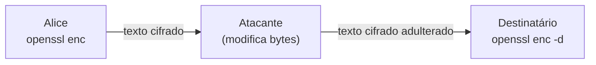

# Laboratório 1: Criptografia Simétrica com OpenSSL

- **Instituição:** Universidade de Brasília (UnB)
- **Departamento:** Departamento de Engenharia Elétrica (ENE)
- **Curso:** Engenharia de Redes de Comunicação e Mestrado Profissional em Engenharia Elétrica (PPEE)
- **Disciplina:** ENE0021 - Tópicos em Redes de Comunicação 3 (oferta conjunta com PPEE2017 - Tópicos em Segurança Cibernética 5)
- **Professor responsável:** Prof. Dr. Laerte Peotta de Melo
- **Tema:** Modos de operação do AES, ChaCha20, vetor de inicialização, cifra autenticada (AEAD), HMAC e desempenho

> **Pré-requisito:** Aula 5 (criptografia simétrica). Este roteiro antecede o Laboratório 2 (criptografia assimétrica).

---

## 1. Objetivos

Ao final do laboratório, o estudante será capaz de:

1. Cifrar e decifrar arquivos com `openssl enc`, derivando a chave a partir de uma senha com PBKDF2 e interpretando o formato do arquivo gerado.
2. Comparar os modos de operação ECB, CBC, CFB, OFB e CTR do AES-256 e a cifra de fluxo ChaCha20.
3. Demonstrar, com dados reais, por que o modo ECB é inseguro e por que o **vetor de inicialização** (*Initialization Vector*, IV) e o ***nonce*** não podem se repetir.
4. Demonstrar que cifras sem autenticação (CBC, CTR) são **maleáveis** e que a **cifra autenticada** (*Authenticated Encryption with Associated Data*, AEAD) detecta a adulteração.
5. Calcular e verificar um código de autenticação de mensagem baseado em *hash* (*Hash-based Message Authentication Code*, HMAC).
6. Medir o desempenho de AES-CBC, AES-GCM e ChaCha20-Poly1305 e relacionar o resultado à escolha de cifras no TLS 1.3 e em VPNs.

---

## 2. Fundamentação Teórica

### 2.1 Princípios de projeto

- **Princípio de Kerckhoffs:** a segurança do sistema deve depender apenas do segredo da chave, nunca do sigilo do algoritmo. Por isso se usam algoritmos públicos e revisados (AES, ChaCha20).
- **Confusão e difusão (Shannon):** a relação entre chave e texto cifrado deve ser complexa (confusão), e cada bit do texto claro deve influenciar muitos bits do texto cifrado (difusão).

### 2.2 Cifras de bloco e de fluxo

| Característica | Cifra de bloco (AES) | Cifra de fluxo (ChaCha20) |
| :--- | :--- | :--- |
| Unidade de processamento | Blocos de 128 bits (16 bytes) | Fluxo de bytes (gerado por um gerador pseudoaleatório) |
| Chave | 128, 192 ou 256 bits | 256 bits |
| Necessita preenchimento (*padding*) | Em ECB e CBC, sim | Não |
| Normas | FIPS 197 | [**RFC 8439**](https://datatracker.ietf.org/doc/html/rfc8439) |
| Aceleração por hardware | Instruções AES-NI e extensões ARM | Eficiente em software (dispositivos sem AES-NI) |

O **DES** (chave de 56 bits) é inseguro por força bruta, e o **3DES** está descontinuado (bloco de 64 bits, ataque Sweet32). O **AES-128** é seguro com a tecnologia atual e o **AES-256** oferece margem adicional, inclusive diante de computadores quânticos (algoritmo de Grover, ver Laboratório 3).

### 2.3 Modos de operação do AES

Uma cifra de bloco cifra apenas um bloco. O **modo de operação** define como ela é aplicada a mensagens maiores.

| Modo | Como funciona | Usa IV ou nonce | Paralelizável (cifrar) | Observações |
| :--- | :--- | :---: | :---: | :--- |
| **ECB** (*Electronic Codebook*) | Cada bloco é cifrado de forma independente | Não | Sim | Blocos iguais geram blocos cifrados iguais: **vaza padrões**. Nunca usar |
| **CBC** (*Cipher Block Chaining*) | Cada bloco é combinado (XOR) com o bloco cifrado anterior | IV aleatório e imprevisível | Não | Exige preenchimento; vulnerável a *padding oracle* se mal implementado |
| **CFB** (*Cipher Feedback*) | Transforma a cifra de bloco em cifra de fluxo com realimentação | IV | Não | Pouco usado atualmente |
| **OFB** (*Output Feedback*) | Gera um fluxo independente do texto claro | IV | Não | Pouco usado atualmente |
| **CTR** (*Counter*) | Cifra um contador e combina o resultado com o texto claro | *Nonce* **único** | Sim | Eficiente. **Repetir o nonce com a mesma chave é catastrófico** |
| **GCM** (*Galois/Counter Mode*) | CTR mais autenticação (GHASH) | *Nonce* de 96 bits **único** | Sim | **AEAD**; base do TLS 1.3 e do IPsec moderno |

### 2.4 IV, *nonce*, preenchimento e autenticação

- O **IV** do CBC deve ser **aleatório e imprevisível** a cada mensagem. Não é segredo e trafega junto com o texto cifrado.
- O ***nonce*** do CTR e do GCM não precisa ser aleatório, mas **nunca pode se repetir** com a mesma chave. A repetição permite recuperar o XOR dos textos claros (experimento da Seção 4.6).
- O **preenchimento** (PKCS#7 no OpenSSL) completa o último bloco no CBC e no ECB. Implementações que revelam se o preenchimento é válido permitem o ataque *padding oracle*.
- Cifrar **não garante integridade**. Sem autenticação, o atacante pode alterar o texto cifrado de forma controlada (maleabilidade). A solução é usar **AEAD** (AES-GCM, ChaCha20-Poly1305), que entrega confidencialidade, integridade e autenticidade na mesma operação, ou, na ausência de AEAD, **cifrar e depois autenticar** (*encrypt-then-MAC*) com chaves distintas.

### 2.5 HMAC e derivação de chave

- O **HMAC** ([**RFC 2104**](https://datatracker.ietf.org/doc/html/rfc2104)) é um código de autenticação calculado com chave secreta compartilhada. Garante integridade e autenticidade, mas **não o não repúdio**, pois as duas partes conhecem a chave.
- Uma **senha** não é uma chave. O `openssl enc` a transforma em chave por meio de uma função de derivação de chave. O padrão histórico (uma única passagem de MD5 ou SHA-256) é fraco, e o OpenSSL emite o aviso `deprecated key derivation used`. A opção `-pbkdf2` ativa o PBKDF2 ([**RFC 8018**](https://datatracker.ietf.org/doc/html/rfc8018)) com um número configurável de iterações (`-iter`).
- O **sal** (*salt*) aleatório garante que a mesma senha produza chaves diferentes a cada cifragem.

### 2.6 Ficha técnica

| Campo | Valor |
| :--- | :--- |
| Ferramenta | `openssl enc` (cifras simétricas sem AEAD), `openssl dgst` e `openssl mac` (HMAC), `openssl speed` (desempenho) e Python com a biblioteca `cryptography` (AEAD) |
| Camada de uso típico | Aplicação (arquivos), TLS (aplicação/transporte), IPsec e WireGuard (rede) |
| Normas | FIPS 197 (AES), [RFC 8439](https://datatracker.ietf.org/doc/html/rfc8439) (ChaCha20-Poly1305), [RFC 5116](https://datatracker.ietf.org/doc/html/rfc5116) (interface AEAD), [RFC 2104](https://datatracker.ietf.org/doc/html/rfc2104) (HMAC), [RFC 8018](https://datatracker.ietf.org/doc/html/rfc8018) (PBKDF2) |

---

## 3. Topologia e Cenário

O laboratório é executado em **um único computador** Linux (Kali, outra distribuição ou WSL). Os papéis são Alice (quem cifra) e o atacante (quem altera o texto cifrado em trânsito).



| Elemento | Valor |
| :--- | :--- |
| Diretório de trabalho | `~/lab-simetrico` |
| Versão mínima do OpenSSL | 3.0 (testado com 3.5.7) |
| Python (Seção 4.7) | Python 3 com o pacote `cryptography` |

---

## 4. Roteiro Prático

### 4.1 Preparação

```bash
# Cria o diretório de trabalho
mkdir -p ~/lab-simetrico && cd ~/lab-simetrico

# Confere a versão do OpenSSL
openssl version

# Cria o arquivo de teste (68 bytes)
printf 'Seguranca de Redes de Computadores\nTeste pratico com AES e ChaCha20\n' > texto.txt
wc -c texto.txt
```

### 4.2 Estrutura do comando `openssl enc`

```bash
openssl enc -cifra [opções] -in entrada -out saida
```

| Opção | Função |
| :--- | :--- |
| `-aes-256-cbc` | Cifra AES com chave de 256 bits no modo CBC. Outras: `-aes-256-ecb`, `-aes-256-cfb`, `-aes-256-ofb`, `-aes-256-ctr`, `-chacha20` |
| `-pbkdf2` | Deriva a chave da senha com PBKDF2 (em vez do método antigo) |
| `-iter N` | Número de iterações do PBKDF2 (implica `-pbkdf2`). Valores mais altos tornam a força bruta mais lenta |
| `-salt` | Usa sal aleatório (padrão). `-nosalt` o desativa e **não deve ser usado** |
| `-pass pass:senha` | Fornece a senha na linha de comando. **Fica no histórico do *shell*; aceitável somente em laboratório** |
| `-d` | Decifra |
| `-K` e `-iv` | Fornecem a chave e o IV diretamente, **em hexadecimal**, sem derivação de senha |
| `-in`, `-out` | Arquivos de entrada e saída |

> **Limitação importante:** o `openssl enc` **não suporta cifras AEAD** (como AES-GCM). A tentativa resulta em `enc: AEAD ciphers not supported`. Por isso o AEAD é demonstrado em Python na Seção 4.7.

### 4.3 Cifragem com senha e leitura do formato do arquivo

Primeiro, observe o aviso do método antigo de derivação de chave:

```bash
# Sem -pbkdf2: o OpenSSL avisa que a derivação é obsoleta
openssl enc -aes-256-cbc -salt -in texto.txt -out antigo.enc -pass pass:lab123
```

```text
*** WARNING : deprecated key derivation used.
Using -iter or -pbkdf2 would be better.
```

Agora, o método recomendado:

```bash
# Cifra: AES-256-CBC, chave derivada por PBKDF2 com 600000 iterações
openssl enc -aes-256-cbc -pbkdf2 -iter 600000 -salt -in texto.txt -out texto_cbc.enc -pass pass:lab123

# Decifra (mesmos parâmetros, mais -d)
openssl enc -d -aes-256-cbc -pbkdf2 -iter 600000 -in texto_cbc.enc -out texto_cbc.dec -pass pass:lab123

# Confirma que o arquivo recuperado é idêntico ao original
diff -s texto.txt texto_cbc.dec

# Examina o início do arquivo cifrado e o tamanho
xxd texto_cbc.enc | head -3
wc -c texto.txt texto_cbc.enc
```

```text
Files texto.txt and texto_cbc.dec are identical
00000000: 5361 6c74 6564 5f5f c328 fe71 c69a 5a0a  Salted__.(.q..Z.
00000010: 22c7 2b2a 53e5 3af8 3fea 3297 f620 9a4a  ".+*S.:.?.2.. .J
00000020: 64f1 f75a 7d14 e1cb e39e 95d3 807d 4736  d..Z}........}G6
  68 texto.txt
  96 texto_cbc.enc
```

Leitura da saída:

- Os 8 primeiros bytes são a assinatura ASCII `Salted__`; os 8 seguintes são o **sal** aleatório (no exemplo, `c328fe71c69a5a0a`). O restante é o texto cifrado. O IV **não** é armazenado: é derivado da senha e do sal, junto com a chave.
- Tamanho: 68 bytes de texto claro, preenchidos para **80 bytes** (múltiplo de 16), mais **16 bytes** de cabeçalho: **96 bytes**.
- O sal e o conteúdo mudam a cada execução, mesmo com a mesma senha e o mesmo texto. Execute o comando duas vezes e compare com `cmp`.

> **Atenção:** a senha deve ter alta entropia. O PBKDF2 retarda, mas não impede a força bruta contra senhas fracas.

### 4.4 Todos os modos de operação e o ChaCha20

```bash
# Cifra e decifra o mesmo arquivo com cada modo e verifica a integridade da recuperação
for m in aes-256-ecb aes-256-cbc aes-256-cfb aes-256-ofb aes-256-ctr chacha20; do
  openssl enc -$m -pbkdf2 -iter 600000 -salt -in texto.txt -out t_$m.enc -pass pass:lab123
  openssl enc -d -$m -pbkdf2 -iter 600000 -in t_$m.enc -out t_$m.dec -pass pass:lab123
  cmp -s texto.txt t_$m.dec && echo "$m OK  tamanho_cifrado=$(wc -c < t_$m.enc)"
done
```

```text
aes-256-ecb OK  tamanho_cifrado=96
aes-256-cbc OK  tamanho_cifrado=96
aes-256-cfb OK  tamanho_cifrado=84
aes-256-ofb OK  tamanho_cifrado=84
aes-256-ctr OK  tamanho_cifrado=84
chacha20 OK  tamanho_cifrado=84
```

Explicação: os modos de bloco com preenchimento (ECB e CBC) produzem 96 bytes (80 mais cabeçalho de 16). Os modos de fluxo (CFB, OFB, CTR e ChaCha20) **não precisam de preenchimento**: 68 bytes mais 16 de cabeçalho resultam em 84 bytes.

### 4.5 Experimento: o ECB vaza padrões

Cria-se uma mensagem com seis blocos **idênticos** de 16 bytes e a cifra-se com ECB, CBC e CTR, usando chave e IV fornecidos diretamente.

```bash
# Mensagem: o mesmo bloco de 16 bytes repetido 6 vezes
python3 -c "import sys; sys.stdout.buffer.write(b'ATAQUE ao ALVO!!' * 6)" > repetido.bin

# Chave de 256 bits e IV de 128 bits aleatórios, em hexadecimal
K=$(openssl rand -hex 32); IV=$(openssl rand -hex 16)

openssl enc -aes-256-ecb -K $K        -in repetido.bin -out rep_ecb.bin
openssl enc -aes-256-cbc -K $K -iv $IV -in repetido.bin -out rep_cbc.bin
openssl enc -aes-256-ctr -K $K -iv $IV -in repetido.bin -out rep_ctr.bin

# Mostra o texto cifrado de cada modo, um bloco de 16 bytes por linha
for m in ecb cbc ctr; do echo "== $m"; xxd -c 16 -p rep_$m.bin; done
```

Saída de exemplo (os valores mudam a cada execução; observe o **padrão**):

```text
== ecb
2a7e21f32501d52618bafd509d95dfcc
2a7e21f32501d52618bafd509d95dfcc
2a7e21f32501d52618bafd509d95dfcc
2a7e21f32501d52618bafd509d95dfcc
2a7e21f32501d52618bafd509d95dfcc
2a7e21f32501d52618bafd509d95dfcc
a27d77ef27c97d340b43f5b81d8d418a
== cbc
4f9a484df077f7eee585ebf9529f43e1
369d43242e80af385c1ac98d5c1d5106
256034456e1586345ec3683014ca76a9
...
```

No **ECB**, os seis blocos cifrados são **idênticos**: o atacante descobre que a mensagem tem blocos repetidos sem conhecer a chave (é o que revela o contorno de imagens cifradas em ECB). No **CBC** e no **CTR**, nenhum bloco se repete. A última linha do ECB e do CBC é o bloco extra de preenchimento.

### 4.6 Experimento: maleabilidade e reutilização de *nonce*

#### 4.6.1 Adulteração sem detecção (CBC e CTR)

```bash
K=$(openssl rand -hex 32); IV=$(openssl rand -hex 16)
printf 'Transferir R$ 100,00 para Alice' > m.txt

# --- CTR: o atacante altera o primeiro dígito do valor (byte 14) sem conhecer a chave
openssl enc -aes-256-ctr -K $K -iv $IV -in m.txt -out m.ctr
python3 - <<'EOF'
b = bytearray(open('m.ctr','rb').read())
b[14] ^= ord('1') ^ ord('9')     # troca '1' por '9' no texto claro
open('m_adulterado.ctr','wb').write(b)
EOF
openssl enc -d -aes-256-ctr -K $K -iv $IV -in m_adulterado.ctr; echo
```

```text
Transferir R$ 900,00 para Alice
```

No CTR, inverter um bit do texto cifrado inverte **exatamente o mesmo bit** do texto claro. O atacante altera o valor de R$ 100,00 para R$ 900,00 e **o destinatário não percebe nada**.

```bash
# --- CBC: alterar o bloco 1 corrompe o bloco 1 e inverte o bit correspondente no bloco 2
openssl enc -aes-256-cbc -K $K -iv $IV -in m.txt -out m.cbc
python3 - <<'EOF'
b = bytearray(open('m.cbc','rb').read())
b[0] ^= 0x01
open('m_adulterado.cbc','wb').write(b)
EOF
openssl enc -d -aes-256-cbc -K $K -iv $IV -in m_adulterado.cbc -out m_dec.txt; echo "código de saída: $?"
xxd m_dec.txt
```

```text
código de saída: 0
00000000: 4bd8 3555 cf23 c3f7 e389 a9ae b2a2 2d03  K.5U.#........-.
00000010: 312c 3030 2070 6172 6120 416c 6963 65    1,00 para Alice
```

No CBC, o primeiro bloco vira lixo, mas o segundo muda de forma **controlada** (`0,00` virou `1,00`) e a decifragem **termina com sucesso** (código 0). Sem autenticação, nenhum dos dois modos detecta a adulteração.

#### 4.6.2 Reutilização de *nonce* no CTR

```bash
printf 'Senha do banco: AbC123' > p1.txt
printf 'Chave do cofre: 998877' > p2.txt

# ERRO PROPOSITAL: mesma chave e mesmo IV para duas mensagens diferentes
openssl enc -aes-256-ctr -K $K -iv $IV -in p1.txt -out c1.bin
openssl enc -aes-256-ctr -K $K -iv $IV -in p2.txt -out c2.bin

python3 - <<'EOF'
c1 = open('c1.bin','rb').read(); c2 = open('c2.bin','rb').read()
p1 = open('p1.txt','rb').read(); p2 = open('p2.txt','rb').read()
x = bytes(a ^ b for a, b in zip(c1, c2))                  # XOR dos dois textos cifrados
print("c1 XOR c2 == p1 XOR p2 ?", x == bytes(a ^ b for a, b in zip(p1, p2)))
print("conhecendo p1, recupera p2:", bytes(a ^ b for a, b in zip(x, p1)))
EOF
```

```text
c1 XOR c2 == p1 XOR p2 ? True
conhecendo p1, recupera p2: b'Chave do cofre: 998877'
```

Com o fluxo de chave reutilizado, o XOR dos textos cifrados é igual ao XOR dos textos claros. Se o atacante conhecer (ou adivinhar) um dos textos, recupera o outro **sem a chave**. Essa é a razão de a unicidade do *nonce* ser obrigatória no CTR, no GCM e no ChaCha20.

### 4.7 Cifra autenticada (AEAD) com Python

Instale a biblioteca, se necessário:

```bash
# Kali e Debian
sudo apt install -y python3-cryptography
# Alternativa: python3 -m pip install cryptography
```

Crie o arquivo `aead.py`:

```python
import os
from cryptography.hazmat.primitives.ciphers.aead import AESGCM, ChaCha20Poly1305
from cryptography.exceptions import InvalidTag

claro = b"Transferir R$ 100,00 para Alice"
aad = b"cabecalho-v1"              # dados associados: autenticados, porém não cifrados

# AES-256-GCM
chave = AESGCM.generate_key(bit_length=256)
aes = AESGCM(chave)
nonce = os.urandom(12)             # 96 bits; nunca repetir com a mesma chave
ct = aes.encrypt(nonce, claro, aad)
print("tamanho claro:", len(claro), "cifrado+tag:", len(ct))
print("decifrado:", aes.decrypt(nonce, ct, aad))

# Adulteração do texto cifrado
adulterado = bytearray(ct); adulterado[10] ^= 0x01
try:
    aes.decrypt(nonce, bytes(adulterado), aad)
except InvalidTag:
    print("AES-GCM: InvalidTag (adulteracao detectada)")

# Alteração dos dados associados
try:
    aes.decrypt(nonce, ct, b"cabecalho-v2")
except InvalidTag:
    print("AES-GCM: InvalidTag (AAD diferente)")

# ChaCha20-Poly1305
cc = ChaCha20Poly1305(ChaCha20Poly1305.generate_key())
n = os.urandom(12)
c = cc.encrypt(n, claro, aad)
print("ChaCha20-Poly1305:", len(c), cc.decrypt(n, c, aad))
```

```bash
python3 aead.py
```

```text
tamanho claro: 31 cifrado+tag: 47
decifrado: b'Transferir R$ 100,00 para Alice'
AES-GCM: InvalidTag (adulteracao detectada)
AES-GCM: InvalidTag (AAD diferente)
ChaCha20-Poly1305: 47 b'Transferir R$ 100,00 para Alice'
```

Explicação: o texto cifrado tem **47 bytes** = 31 do texto claro + **16 bytes da etiqueta de autenticação** (*tag*). A alteração de **um único bit** (ou dos dados associados) faz a decifragem **falhar com `InvalidTag`**, diferentemente do CBC e do CTR da Seção 4.6.1. É por isso que o TLS 1.3 admite somente cifras AEAD ([RFC 8446](https://datatracker.ietf.org/doc/html/rfc8446)).

### 4.8 HMAC

```bash
# HMAC-SHA-256 do arquivo com a chave "chave-lab" (somente laboratório)
openssl dgst -sha256 -hmac "chave-lab" texto.txt

# Mesma operação com o comando openssl mac
openssl mac -digest SHA256 -macopt key:chave-lab HMAC < texto.txt

# Altera um caractere e recalcula: o HMAC muda por completo
sed 's/Redes/redes/' texto.txt > texto_alterado.txt
openssl dgst -sha256 -hmac "chave-lab" texto_alterado.txt
```

O HMAC é um valor de 256 bits (64 caracteres hexadecimais) e **qualquer** alteração do arquivo, ou o uso de outra chave, produz um valor totalmente diferente. Uma assinatura digital (Laboratório 2) também garante integridade, mas acrescenta o **não repúdio**, que o HMAC não oferece.

### 4.9 Desempenho

```bash
# Mede a vazão (1 segundo por teste) de AES-CBC, AES-GCM e ChaCha20-Poly1305
openssl speed -seconds 1 -evp AES-256-CBC
openssl speed -seconds 1 -evp AES-256-GCM
openssl speed -seconds 1 -evp ChaCha20-Poly1305
```

Saída de exemplo (valores em milhares de bytes por segundo; **dependem do processador**):

```text
type             16 bytes     64 bytes    256 bytes   1024 bytes   8192 bytes  16384 bytes
AES-256-CBC     599835.19k   905089.90k   948152.18k   909131.00k   943168.74k   976241.73k
AES-256-GCM      61690.64k   184280.82k   670897.59k  1822114.36k  3106482.51k  2402608.95k
ChaCha20-Poly1305 244528.83k 306216.34k   498857.69k   907421.29k  1476953.68k   679172.82k
```

Leitura: em um processador com instruções AES-NI, o AES-GCM atingiu cerca de **3,1 GB/s** em blocos de 8 KB, contra cerca de 0,94 GB/s do AES-CBC e 1,5 GB/s do ChaCha20-Poly1305. O CBC é limitado por ser **serial** (cada bloco depende do anterior); o GCM é paralelizável. Para pacotes pequenos (16 bytes), o ChaCha20-Poly1305 supera o AES-GCM nesta máquina. Em dispositivos **sem** aceleração de AES (telefones antigos, microcontroladores), o ChaCha20 tende a ser mais rápido que o AES, e é essa a razão de sua adoção no TLS 1.3 e no WireGuard. Registre a marca e o modelo do seu processador no relatório e justifique as diferenças.

---

## 5. Verificação e Diagnóstico

| Sintoma | Causa provável | Correção |
| :--- | :--- | :--- |
| `bad decrypt` (`ossl_cipher_unpadblock`) | Senha incorreta, ou `-iter`, `-pbkdf2` ou cifra diferentes entre cifragem e decifragem | Usar **exatamente** os mesmos parâmetros nas duas operações |
| `*** WARNING : deprecated key derivation used` | Falta de `-pbkdf2` ou `-iter` | Acrescentar `-pbkdf2 -iter 600000` |
| `enc: AEAD ciphers not supported` | Tentativa de usar GCM ou ChaCha20-Poly1305 no `enc` | Usar Python (Seção 4.7) ou uma biblioteca/protocolo com suporte a AEAD, como o TLS |
| `hex string is too short, padding with zero bytes to length` | `-K` ou `-iv` menores que o exigido: o OpenSSL completa com zeros e **segue** (chave fraca sem erro) | AES-256 exige chave de 64 hexadecimais; IV de 32 hexadecimais (AES e ChaCha20 no `enc`) |
| `ModuleNotFoundError: cryptography` | Biblioteca ausente | `sudo apt install -y python3-cryptography` |
| Arquivo decifrado diferente do original | Edição do arquivo cifrado ou modo errado | Comparar com `cmp` e refazer a cifragem |

---

## 6. Segurança e Boas Práticas

1. **Nunca use ECB.** Prefira AEAD (AES-GCM ou ChaCha20-Poly1305). Sem AEAD, use *encrypt-then-MAC*.
2. **Nunca repita o par (chave, *nonce*)** em CTR, GCM e ChaCha20. Gere o *nonce* de forma aleatória (96 bits) ou por contador controlado.
3. **Não use `-pass pass:...` fora do laboratório**: a senha fica no histórico e na lista de processos. Prefira `-pass file:` ou a leitura interativa.
4. **Gere chaves com fonte aleatória criptográfica** (`openssl rand`, `os.urandom`) e as armazene em cofre, HSM ou serviço de gestão de chaves (*Key Management Service*, KMS). O ciclo de vida inclui geração, distribuição, armazenamento, uso, rotação e destruição.
5. **Compare MACs em tempo constante** em aplicações reais (por exemplo, `hmac.compare_digest` em Python).
6. **Limitação:** o `openssl enc` é uma ferramenta didática e de uso eventual. Para proteger dados em produção, use bibliotecas e formatos autenticados e revisados.

---

## 7. Perguntas para Fixação

1. Por que o ECB é considerado inseguro mesmo sendo rápido? Relacione sua resposta ao experimento da Seção 4.5.
2. Qual é a diferença entre IV e *nonce*? O que acontece se o *nonce* do CTR for reutilizado?
3. Por que o CBC e o CTR não detectam adulteração? Como o AEAD resolve o problema?
4. Por que a etiqueta de autenticação aumenta o texto cifrado em 16 bytes?
5. Por que o ChaCha20 foi adotado no TLS 1.3 e no WireGuard mesmo havendo o AES? Em que cenário ele é mais vantajoso?
6. Por que o AES-256 continua sendo considerado adequado diante de computadores quânticos?
7. Qual é a diferença entre HMAC e assinatura digital? Que propriedade o HMAC não oferece?

---

## 8. Critérios de Avaliação

| Critério | Pontos |
| :--- | ---: |
| Cifragem e decifragem com PBKDF2 e análise do formato (`Salted__`, sal e tamanho) | 1,5 |
| Execução e verificação de todos os modos e do ChaCha20 | 1,0 |
| Experimento do ECB com análise dos blocos repetidos | 1,5 |
| Experimentos de maleabilidade e de reutilização de *nonce* com análise | 2,0 |
| AEAD em Python: detecção de adulteração e análise do tamanho da etiqueta | 1,5 |
| HMAC (cálculo e sensibilidade a alterações) | 0,5 |
| Medição de desempenho e justificativa | 1,0 |
| Respostas às perguntas de fixação | 1,0 |
| **Total** | **10,0** |

---

## 9. Entregáveis

1. Relatório em **PDF**, com capa (nome, matrícula, disciplina e data), capturas de tela ou trechos de terminal e respostas organizadas por seção.
2. Evidências de cada etapa: saída do `xxd` do arquivo cifrado, laço dos modos, blocos do ECB comparados aos do CBC e do CTR, experimentos da Seção 4.6, saída do `aead.py`, HMAC e `openssl speed`.
3. Tabela de desempenho com **as medições do próprio aluno** e identificação do processador.
4. Respostas às perguntas da Seção 7.
5. **Prazo:** até as 23:59 do dia anterior à próxima aula. **Formato:** PDF. **Envio:** individual, pela tarefa no Microsoft Teams.

---

## 10. Conclusão

A escolha da cifra é apenas parte do problema: o modo de operação, o gerenciamento de IV e *nonce* e, sobretudo, a autenticação determinam a segurança real. Os experimentos mostram que o ECB vaza padrões, que CBC e CTR sem autenticação são maleáveis e que a reutilização de *nonce* destrói o sigilo. A cifra autenticada (AES-GCM e ChaCha20-Poly1305) resolve esses problemas e é o que protocolos modernos como TLS 1.3, IPsec e WireGuard exigem.

---

## 11. Referências

- NIST. **FIPS 197**: Advanced Encryption Standard (AES), 2001.
- NIST. **SP 800-38A** (modos de operação) e **SP 800-38D** (GCM).
- IETF. [**RFC 8439**](https://datatracker.ietf.org/doc/html/rfc8439): ChaCha20 and Poly1305 for IETF Protocols.
- IETF. [**RFC 5116**](https://datatracker.ietf.org/doc/html/rfc5116): An Interface and Algorithms for Authenticated Encryption.
- IETF. [**RFC 2104**](https://datatracker.ietf.org/doc/html/rfc2104): HMAC: Keyed-Hashing for Message Authentication.
- IETF. [**RFC 8018**](https://datatracker.ietf.org/doc/html/rfc8018): PKCS #5: Password-Based Cryptography Specification Version 2.1.
- IETF. [**RFC 8446**](https://datatracker.ietf.org/doc/html/rfc8446): The Transport Layer Security (TLS) Protocol Version 1.3.

---

[← Anterior](../README.md) | [Índice Geral (README)](../README.md) | [Próximo →](lab02.md)
