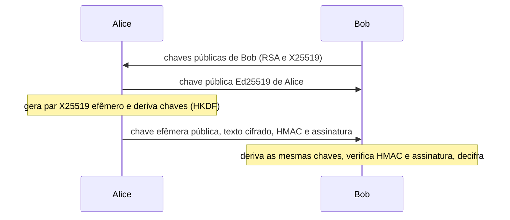

# Laboratório 2: Criptografia Assimétrica, Assinaturas Digitais e Funções Hash com OpenSSL

- **Instituição:** Universidade de Brasília (UnB)
- **Departamento:** Departamento de Engenharia Elétrica (ENE)
- **Curso:** Engenharia de Redes de Comunicação e Mestrado Profissional em Engenharia Elétrica (PPEE)
- **Disciplina:** ENE0021 - Tópicos em Redes de Comunicação 3 (oferta conjunta com PPEE2017 - Tópicos em Segurança Cibernética 5)
- **Professor responsável:** Prof. Dr. Laerte Peotta de Melo
- **Tema:** RSA-OAEP, RSA-PSS, Ed25519, acordo de chaves X25519, derivação HKDF, cifragem híbrida, funções *hash* e armazenamento de senhas

> **Pré-requisito:** Laboratório 1 (criptografia simétrica) e Aula 6 (criptografia assimétrica, assinaturas digitais e hash). Este roteiro antecede o Laboratório 3 (criptografia pós-quântica).

---

## 1. Objetivos

Ao final do laboratório, o estudante será capaz de:

1. Calcular e comparar *hash* com SHA-256, SHA3-256 e BLAKE2, demonstrar o efeito avalanche e justificar por que o MD5 não deve ser usado.
2. Gerar pares de chaves RSA, X25519 e Ed25519 e comparar seus tamanhos.
3. Cifrar uma mensagem curta com **RSA-OAEP** e explicar a função do preenchimento.
4. Assinar e verificar mensagens com **RSA-PSS** e **Ed25519**, e demonstrar a detecção de adulteração.
5. Executar um acordo de chaves **X25519** (*Elliptic Curve Diffie-Hellman*, ECDH) e derivar chaves de sessão com **HKDF**.
6. Construir uma **cifragem híbrida** completa (acordo de chaves efêmero, cifra simétrica, HMAC e assinatura) e verificá-la do lado do destinatário.
7. Armazenar senhas de forma adequada com uma função de derivação lenta (**Argon2id**) e explicar por que um *hash* simples é insuficiente.

---

## 2. Fundamentação Teórica

### 2.1 Por que a criptografia assimétrica

A criptografia simétrica exige que as duas partes já compartilhem uma chave, o que cria o problema da **distribuição de chaves**. A criptografia assimétrica usa **pares de chaves** (pública e privada) e resolve três problemas distintos, cada um com algoritmos próprios:

| Problema | Mecanismo | Algoritmos usados neste laboratório |
| :--- | :--- | :--- |
| Entregar um segredo ao destinatário | Cifragem de chave pública ou encapsulamento | RSA-OAEP |
| Chegar a um segredo compartilhado sem trafegá-lo | Acordo de chaves | X25519 (ECDH) |
| Provar autoria e integridade, com não repúdio | Assinatura digital | RSA-PSS, Ed25519 |

Algoritmos de chave pública são lentos e limitados quanto ao tamanho dos dados. Por isso, os protocolos reais usam a **criptografia híbrida**: a parte assimétrica estabelece uma chave de sessão, e uma cifra simétrica autenticada protege o volume de dados. É o princípio do TLS, do IPsec e do PGP.

### 2.2 RSA e o preenchimento

O RSA baseia-se na dificuldade de fatorar o produto de dois primos grandes. O **RSA "puro"** (sem preenchimento) é determinístico e maleável, portanto inseguro. Usam-se dois esquemas padronizados no [**PKCS #1 v2.2 (RFC 8017)**](https://datatracker.ietf.org/doc/html/rfc8017):

- **RSA-OAEP** (*Optimal Asymmetric Encryption Padding*): para **cifrar**. Mistura a mensagem com uma semente aleatória e duas funções *hash* (e uma função de geração de máscara, MGF1). Resultado: cada cifragem da mesma mensagem produz um texto cifrado **diferente**, e ataques de oráculo de preenchimento são dificultados. Substitui o antigo PKCS#1 v1.5.
- **RSA-PSS** (*Probabilistic Signature Scheme*): para **assinar**. Incorpora um sal aleatório e tem prova de segurança, ao contrário do PKCS#1 v1.5 de assinatura (ainda comum por compatibilidade).

O tamanho recomendado da chave RSA é de **no mínimo 3072 bits** para novos projetos (cerca de 128 bits de segurança), sendo 2048 bits aceitável apenas em contextos legados.

### 2.3 Curvas elípticas, X25519 e Ed25519

A criptografia de curvas elípticas (*Elliptic Curve Cryptography*, ECC) oferece o mesmo nível de segurança com chaves muito menores. Neste laboratório:

- **X25519** ([**RFC 7748**](https://datatracker.ietf.org/doc/html/rfc7748)): acordo de chaves Diffie-Hellman sobre a Curva25519. Chaves de 32 bytes. Duas partes, com seus pares de chaves, chegam ao **mesmo segredo de 32 bytes**.
- **Ed25519** ([**RFC 8032**](https://datatracker.ietf.org/doc/html/rfc8032)): assinatura digital EdDSA sobre a mesma curva. Assinatura de 64 bytes, determinística (não depende de bom gerador de números aleatórios na assinatura).

| Algoritmo | Chave pública (DER) | Assinatura | Segurança aproximada |
| :--- | ---: | ---: | :--- |
| RSA-2048 | 294 bytes | 256 bytes | 112 bits |
| RSA-3072 | 422 bytes | 384 bytes | 128 bits |
| ECDSA P-256 | 91 bytes | cerca de 71 bytes | 128 bits |
| Ed25519 | 44 bytes | 64 bytes | 128 bits |

### 2.4 Diffie-Hellman efêmero e sigilo futuro

No acordo de chaves, cada parte combina **sua chave privada** com a **chave pública da outra**, e ambas obtêm o mesmo segredo. A versão **efêmera** (ECDHE) usa um **par novo a cada sessão**, descartado em seguida. Disso decorre o **sigilo futuro** (*forward secrecy*): o vazamento posterior da chave de longo prazo não permite decifrar sessões passadas. O acordo de chaves **sem autenticação** é vulnerável a ataque de homem no meio (*man-in-the-middle*, MITM): por isso a troca é autenticada por assinatura ou certificado.

O segredo bruto do acordo **não deve ser usado diretamente como chave**: ele passa por uma função de derivação, o **HKDF** ([**RFC 5869**](https://datatracker.ietf.org/doc/html/rfc5869)), que produz chaves independentes para cada finalidade (cifra, MAC, IV).

### 2.5 Funções *hash*

Uma função *hash* criptográfica produz um resumo de tamanho fixo, com três propriedades: resistência a **pré-imagem**, a **segunda pré-imagem** e a **colisões**. Qualquer alteração mínima da entrada altera o resumo por completo (**efeito avalanche**).

| Função | Tamanho | Situação |
| :--- | ---: | :--- |
| MD5 | 128 bits | **Quebrada** (colisões práticas). Não usar para segurança |
| SHA-1 | 160 bits | **Quebrada** para colisões. Descontinuada |
| SHA-256 e SHA-512 (SHA-2) | 256 e 512 bits | Seguras e amplamente usadas |
| SHA3-256 (Keccak) | 256 bits | Segura; construção diferente da SHA-2 |
| BLAKE2b | até 512 bits | Segura e muito rápida |

### 2.6 Armazenamento de senhas

Nunca se armazena a senha, nem um *hash* simples dela (MD5, SHA-1, SHA-256 puros), pois são rápidos demais e permitem bilhões de tentativas por segundo em GPUs. Usa-se uma função **lenta**, com **sal único por usuário** e custo configurável: **Argon2id** ([**RFC 9106**](https://datatracker.ietf.org/doc/html/rfc9106)), *scrypt* ou *bcrypt*. O Argon2id exige memória (*memory-hard*), o que encarece ataques com hardware especializado.

### 2.7 MAC e assinatura digital

| Aspecto | MAC e HMAC | Assinatura digital |
| :--- | :--- | :--- |
| Chave | Secreta e compartilhada | Par privada e pública |
| Integridade e autenticidade | Sim | Sim |
| Não repúdio | **Não** (qualquer parte com a chave poderia ter gerado) | **Sim** |
| Desempenho | Muito rápido | Mais lento |

### 2.8 Nota sobre computação quântica

RSA, ECDH e Ed25519 serão quebrados por um computador quântico criptograficamente relevante (algoritmo de Shor). Este laboratório trabalha com os algoritmos clássicos, ainda indispensáveis hoje. A migração para ML-KEM e ML-DSA é tema do **Laboratório 3**.

---

## 3. Topologia e Cenário

O experimento ocorre em **um único computador** Linux (Kali, outra distribuição ou WSL), com os papéis Alice (remetente) e Bob (destinatário).



| Elemento | Valor |
| :--- | :--- |
| Diretório de trabalho | `~/lab-assimetrico` |
| Versão mínima do OpenSSL | 3.2 para o comando `kdf` com Argon2 (testado com 3.5.7) |
| Convenção de nomes | `<pessoa>.<algoritmo>.key` (privada) e `<pessoa>.<algoritmo>.pub` (pública) |

---

## 4. Roteiro Prático

### 4.1 Preparação

```bash
# Cria o diretório de trabalho
mkdir -p ~/lab-assimetrico && cd ~/lab-assimetrico

# Confere a versão do OpenSSL
openssl version

# Mensagem curta de teste
printf 'Relatorio confidencial do laboratorio\n' > message.plain
```

### 4.2 Funções *hash* e efeito avalanche

```bash
# Hash da mesma mensagem com algoritmos diferentes
for h in sha256 sha3-256 blake2b512 md5; do openssl dgst -$h message.plain; done
```

```text
SHA2-256(message.plain)= 14278e13466f133e41c001eaf75d38d92eae0c0a9506eb0455b3a6bdd92b17b9
SHA3-256(message.plain)= b6ac933ad88139f07b5d44cc7973b6fe2dfca1acfdc4034fbd521cd47c5e665d
BLAKE2B-512(message.plain)= 788366c5fc33036682bb6c46fc1482263020917f2f2f6900c84debac795caa120296f611a134807fc1b9e85bd20f50799d90cfcff46df5e2a52a14b674ca63d1
MD5(message.plain)= 34e019bbdaf600c1b6a6fe93bceda941
```

Os tamanhos são, respectivamente, 256, 256, 512 e 128 bits (64, 64, 128 e 32 caracteres hexadecimais). **Efeito avalanche:** altere uma única letra da entrada e compare.

```bash
echo "Relatorio" | openssl dgst -sha256
echo "relatorio" | openssl dgst -sha256
```

```text
SHA2-256(stdin)= 3e11d14fec5b979124776255289147d645a088c2fb7cb7d979c5d0e4845d2e71
SHA2-256(stdin)= cee3a2ea49b1bb2fe24476a86472e55e119ac02c0f12e7e3c8e6d10b1b2e81a0
```

A mudança de maiúscula para minúscula em **um** caractere altera o resumo inteiro. Registre no relatório o número aproximado de bits diferentes entre os dois resumos (esperado: cerca de metade).

### 4.3 Geração de chaves

```bash
for p in alice bob; do
  # RSA de 3072 bits (PKCS#8)
  openssl genpkey -algorithm RSA -pkeyopt rsa_keygen_bits:3072 -out $p.rsa.key
  openssl pkey -in $p.rsa.key -pubout -out $p.rsa.pub

  # X25519 (acordo de chaves)
  openssl genpkey -algorithm X25519 -out $p.x.key
  openssl pkey -in $p.x.key -pubout -out $p.x.pub

  # Ed25519 (assinatura)
  openssl genpkey -algorithm ED25519 -out $p.ed.key
  openssl pkey -in $p.ed.key -pubout -out $p.ed.pub
done

# Protege todas as chaves privadas: somente o dono lê e escreve
chmod 600 *.key
ls -l *.key *.pub
```

Parâmetros:

- `genpkey` gera uma chave privada em PKCS#8; `-algorithm` escolhe o algoritmo; `-pkeyopt rsa_keygen_bits:3072` define o tamanho da chave RSA.
- `pkey -pubout` extrai a chave pública a partir da privada.
- `chmod 600` restringe a leitura ao proprietário.

Meça o tamanho da chave pública de cada tipo e compare com a tabela da Seção 2.3:

```bash
for k in alice.rsa alice.x alice.ed; do echo "$k $(openssl pkey -in $k.pub -pubin -pubout -outform DER | wc -c) bytes"; done
```

```text
alice.rsa 422 bytes
alice.x 44 bytes
alice.ed 44 bytes
```

### 4.4 RSA-OAEP: mensagem curta confidencial (Alice para Bob)

```bash
# Alice cifra com a chave PÚBLICA de Bob
openssl pkeyutl -encrypt -in message.plain -out message.encrypted \
  -pubin -inkey bob.rsa.pub \
  -pkeyopt rsa_padding_mode:oaep \
  -pkeyopt rsa_oaep_md:sha256 \
  -pkeyopt rsa_mgf1_md:sha256

# Bob decifra com a chave PRIVADA
openssl pkeyutl -decrypt -in message.encrypted -out message.decrypted \
  -inkey bob.rsa.key \
  -pkeyopt rsa_padding_mode:oaep \
  -pkeyopt rsa_oaep_md:sha256 \
  -pkeyopt rsa_mgf1_md:sha256

diff -s message.plain message.decrypted
wc -c message.encrypted
```

```text
Files message.plain and message.decrypted are identical
384 message.encrypted
```

Parâmetros: `-pubin` indica que `-inkey` contém uma chave pública; `rsa_padding_mode:oaep` seleciona o preenchimento OAEP; `rsa_oaep_md` e `rsa_mgf1_md` definem o *hash* do OAEP e o da função de máscara (ambos SHA-256). O texto cifrado tem **384 bytes**, exatamente o tamanho da chave RSA-3072, independentemente do tamanho da mensagem.

**Experimento (aleatoriedade do OAEP):** cifre a **mesma** mensagem duas vezes e compare os resultados com `cmp`. Eles serão diferentes, pois o OAEP incorpora uma semente aleatória. Registre a evidência.

**Limite de tamanho:** com RSA-3072 e OAEP-SHA-256, a mensagem não pode exceder 384 - 2×32 - 2 = **318 bytes** (confirmado: 318 bytes cifram, 319 falham com `data too large for key size`). Para mensagens maiores, usa-se a cifragem híbrida (Seção 4.7).

### 4.5 Assinatura digital: RSA-PSS e Ed25519

```bash
# --- RSA-PSS: Alice assina com sua chave PRIVADA
openssl dgst -sha256 -sign alice.rsa.key \
  -sigopt rsa_padding_mode:pss -sigopt rsa_pss_saltlen:-1 \
  -out pss.sig message.plain

# Bob verifica com a chave PÚBLICA de Alice
openssl dgst -sha256 -verify alice.rsa.pub \
  -sigopt rsa_padding_mode:pss -sigopt rsa_pss_saltlen:-1 \
  -signature pss.sig message.plain

# --- Ed25519: assinatura da mensagem inteira (-rawin)
openssl pkeyutl -sign -inkey alice.ed.key -rawin -in message.plain -out ed.sig
openssl pkeyutl -verify -pubin -inkey alice.ed.pub -rawin -in message.plain -sigfile ed.sig

wc -c pss.sig ed.sig
```

```text
Verified OK
Signature Verified Successfully
 384 pss.sig
  64 ed.sig
 448 total
```

Parâmetros: `-sigopt rsa_padding_mode:pss` seleciona o RSA-PSS; `rsa_pss_saltlen:-1` define o sal com o tamanho do *hash*; `-rawin` informa que a entrada é a mensagem completa (o Ed25519 faz o *hash* internamente).

**Teste de adulteração:**

```bash
cp message.plain message.tampered
echo "x" >> message.tampered
openssl pkeyutl -verify -pubin -inkey alice.ed.pub -rawin -in message.tampered -sigfile ed.sig
echo "código de saída: $?"
```

A verificação deve **falhar** (`Signature Verification Failure`, código de saída 1). Registre a saída. A assinatura Ed25519 tem 64 bytes contra 384 do RSA-3072, para o mesmo nível de segurança.

### 4.6 Acordo de chaves X25519 e derivação com HKDF

```bash
# Alice combina SUA privada com a pública de Bob
openssl pkeyutl -derive -inkey alice.x.key -peerkey bob.x.pub -out segredo_alice.bin

# Bob combina a SUA privada com a pública de Alice
openssl pkeyutl -derive -inkey bob.x.key -peerkey alice.x.pub -out segredo_bob.bin

cmp segredo_alice.bin segredo_bob.bin && echo "SEGREDOS IGUAIS"
wc -c segredo_alice.bin
```

```text
SEGREDOS IGUAIS
32 segredo_alice.bin
```

As duas partes chegaram ao mesmo segredo de 32 bytes **sem trafegá-lo**; apenas as chaves públicas circularam. Agora, derive chaves a partir dele com o HKDF:

```bash
# Deriva 32 bytes (SHA-256) com um rótulo de contexto (info)
openssl kdf -keylen 32 -kdfopt digest:SHA256 \
  -kdfopt hexkey:$(xxd -p -c 100 segredo_alice.bin) \
  -kdfopt info:lab-hibrido HKDF
```

O resultado é uma chave de 32 bytes, exibida em hexadecimal separada por dois-pontos. O parâmetro `info` vincula a chave ao seu **contexto de uso**: contextos diferentes produzem chaves diferentes a partir do mesmo segredo.

### 4.7 Cifragem híbrida completa (mensagem grande, Alice para Bob)

Alice protege uma mensagem grande combinando: **X25519 efêmero do lado de Alice** (acordo de chaves), **HKDF** (derivação), **AES-256-CBC** (cifra simétrica), **HMAC-SHA-256** (autenticação do texto cifrado, *encrypt-then-MAC*) e **Ed25519** (assinatura da mensagem, que dá autoria e não repúdio).

**Passo 1: Alice prepara os dados e as chaves.**

```bash
# Mensagem grande (cerca de 135 KB)
head -c 100000 /dev/urandom | base64 > big.plain

# Par X25519 EFÊMERO de Alice (descartado ao final)
openssl genpkey -algorithm X25519 -out eph.key
openssl pkey -in eph.key -pubout -out eph.pub

# Segredo efêmero com a chave pública ESTÁTICA de Bob e derivação de 80 bytes
openssl pkeyutl -derive -inkey eph.key -peerkey bob.x.pub -out ss.bin
openssl kdf -keylen 80 -binary -kdfopt digest:SHA256 \
  -kdfopt hexkey:$(xxd -p -c 100 ss.bin) -kdfopt info:lab-hibrido HKDF > okm.bin

# Separa os 80 bytes: 32 (chave AES) + 16 (IV) + 32 (chave do HMAC)
head -c 32 okm.bin > k_enc.bin
dd if=okm.bin of=iv.bin    bs=1 skip=32 count=16 status=none
dd if=okm.bin of=k_mac.bin bs=1 skip=48 count=32 status=none
```

**Passo 2: Alice cifra, autentica e assina.**

```bash
# Cifra com AES-256-CBC (chave e IV vindos do HKDF)
openssl enc -aes-256-cbc -K $(xxd -p -c 100 k_enc.bin) -iv $(xxd -p -c 100 iv.bin) \
  -in big.plain -out big.enc

# HMAC-SHA-256 sobre o TEXTO CIFRADO (encrypt-then-MAC)
openssl dgst -sha256 -mac HMAC -macopt hexkey:$(xxd -p -c 100 k_mac.bin) \
  -binary -out big.tag big.enc

# Assinatura Ed25519 da mensagem em claro
openssl pkeyutl -sign -inkey alice.ed.key -rawin -in big.plain -out big.sig

wc -c big.enc big.tag big.sig
```

```text
135104 big.enc
    32 big.tag
    64 big.sig
```

Alice envia a Bob: `eph.pub`, `big.enc`, `big.tag` e `big.sig`. **Não envia** nenhuma chave simétrica nem o segredo `ss.bin`.

**Passo 3: Bob verifica e decifra.** Bob usa somente o que recebeu (`eph.pub`, `big.enc`, `big.tag`, `big.sig`) e a sua chave privada. Os arquivos de chaves de Bob recebem nomes próprios (`b_enc.bin`, `b_iv.bin` e `b_mac.bin`) para deixar claro que foram **derivados por ele**.

```bash
# Bob deriva o MESMO segredo com sua chave privada e a pública efêmera de Alice
openssl pkeyutl -derive -inkey bob.x.key -peerkey eph.pub -out ss2.bin
openssl kdf -keylen 80 -binary -kdfopt digest:SHA256   -kdfopt hexkey:$(xxd -p -c 100 ss2.bin) -kdfopt info:lab-hibrido HKDF > okm2.bin
cmp okm.bin okm2.bin && echo "CHAVES DERIVADAS IGUAIS"

# Bob separa os 80 bytes exatamente como Alice fez
head -c 32 okm2.bin > b_enc.bin
dd if=okm2.bin of=b_iv.bin  bs=1 skip=32 count=16 status=none
dd if=okm2.bin of=b_mac.bin bs=1 skip=48 count=32 status=none

# 1) Verifica o HMAC ANTES de decifrar
openssl dgst -sha256 -mac HMAC -macopt hexkey:$(xxd -p -c 100 b_mac.bin) -binary big.enc   | cmp - big.tag && echo "HMAC OK"

# 2) Decifra
openssl enc -d -aes-256-cbc -K $(xxd -p -c 100 b_enc.bin) -iv $(xxd -p -c 100 b_iv.bin)   -in big.enc -out big.dec

# 3) Verifica a assinatura de Alice
openssl pkeyutl -verify -pubin -inkey alice.ed.pub -rawin -in big.dec -sigfile big.sig

diff -s big.plain big.dec
```

```text
CHAVES DERIVADAS IGUAIS
HMAC OK
Signature Verified Successfully
Files big.plain and big.dec are identical
```

**Teste de adulteração do texto cifrado:**

```bash
python3 -c "
b = bytearray(open('big.enc','rb').read()); b[1000] ^= 1
open('big_adulterado.enc','wb').write(b)"
openssl dgst -sha256 -mac HMAC -macopt hexkey:$(xxd -p -c 100 b_mac.bin) -binary big_adulterado.enc \
  | cmp - big.tag
echo "código de saída: $?"
```

```text
- big.tag differ: byte 1, line 1
código de saída: 1
```

O HMAC detecta a alteração de **um único bit**, e Bob deve descartar a mensagem **sem decifrá-la**. Essa verificação prévia evita a exposição a ataques de oráculo de preenchimento do CBC.

**Análise do sigilo futuro (para o relatório):** apague a chave efêmera de Alice (`shred -u eph.key`). Suponha que, no futuro, a chave **estática** de Bob (`bob.x.key`) seja roubada e que o atacante tenha gravado `eph.pub`, `big.enc`, `big.tag` e `big.sig`. Responda: (a) o atacante consegue decifrar a mensagem? Justifique com a fórmula do segredo (a privada de Bob combinada com a pública efêmera de Alice produz o mesmo segredo); (b) o que mudaria se Alice, em vez disso, perdesse apenas `eph.key` **sem tê-la apagado**; (c) por que o ECDHE do TLS 1.3, que efemeriza **os dois lados**, não tem essa limitação.

### 4.8 Armazenamento de senhas: hash simples versus Argon2id

```bash
# SHA-256 puro: rápido demais para armazenar senhas (NÃO USAR)
printf 'senha123' | openssl dgst -sha256

# crypt SHA-512 (opção legada do sistema), com sal e muitas iterações internas
openssl passwd -6 -salt abcdefgh senha123

# Argon2id: 3 iterações, 64 MiB de memória, 4 faixas (lanes), 1 thread; sal de 16 bytes
time openssl kdf -keylen 32 \
  -kdfopt pass:senha123 -kdfopt salt:saltsaltsaltsalt \
  -kdfopt iter:3 -kdfopt memcost:65536 -kdfopt lanes:4 -kdfopt threads:1 ARGON2ID
```

```text
$6$abcdefgh$.8KK0VIa8Y1pYzj8zjjDgwJjGUnaeddDMDM2JBB0eiVxHt.18CmokxU63XgCMtbd4qWca4sTEcKYrs0R39sre/
83:1D:24:58:71:9B:16:67:00:F0:5E:46:F3:7A:C8:E3:F3:98:6D:68:24:A8:C6:F5:69:71:9E:67:F0:D8:CD:33
```

Parâmetros do Argon2id: `iter` (passes), `memcost` (memória em KiB: 65536 KiB = 64 MiB), `lanes` (paralelismo), `threads` (threads usadas), `salt` (mínimo de 8 bytes; use 16 aleatórios por usuário). Em produção, o sal vem de `openssl rand` e o custo é calibrado para algo em torno de dezenas a centenas de milissegundos por verificação.

**Experimento:** repita o Argon2id com `iter:1 memcost:1024 lanes:1` e compare o tempo (`time`) com a configuração anterior. Em seguida, calcule o SHA-256 e meça o tempo. Registre as três medições e explique, em termos de ataque por força bruta, por que o custo configurável e o uso de memória são vantagens.

> **Limitação:** o comando `openssl kdf ARGON2ID` está disponível a partir do OpenSSL 3.2 e a saída tem formato **bruto** (não é o formato PHC `$argon2id$...` usado em aplicações). Em sistemas reais, use bibliotecas que gerem e verifiquem o formato completo.

### 4.9 Desempenho (opcional)

```bash
openssl speed -seconds 1 rsa2048 ecdsap256 ed25519 ecdhx25519
```

Compare as operações por segundo de assinatura e verificação. Resultado de referência (depende do processador): o RSA-2048 assina cerca de 1400 vezes por segundo e verifica cerca de 36 mil, enquanto o Ed25519 assina cerca de 19 mil e verifica cerca de 8 mil: o **RSA tem verificação rápida e assinatura lenta**; as curvas elípticas, o inverso, com chaves bem menores.

---

## 5. Verificação e Diagnóstico

| Sintoma | Causa provável | Correção |
| :--- | :--- | :--- |
| `data too large for key size` (`Public Key operation error`) | Mensagem maior que o limite do RSA-OAEP | Usar a cifragem híbrida (Seção 4.7) |
| `oaep decoding error` | Parâmetros OAEP diferentes na cifragem e na decifragem, ou chave errada | Repetir os mesmos `-pkeyopt` nas duas operações |
| `Verification failure` em RSA-PSS | Opção `-sigopt` diferente da usada na assinatura, ou arquivo alterado | Usar os mesmos `-sigopt` e o arquivo original |
| `Signature Verification Failure` (Ed25519) | Mensagem ou assinatura alterada, ou chave pública errada | Conferir `-in`, `-sigfile` e `-inkey` |
| `cmp` acusa diferença nos segredos X25519 | Chaves trocadas (privada com a própria pública) | Combinar a privada de uma parte com a pública da **outra** |
| `Invalid KDF name ARGON2ID` | OpenSSL anterior a 3.2 | Atualizar o OpenSSL; o HKDF exige 3.0 ou superior |
| `Permission denied` ao usar uma chave | Permissões incorretas ou arquivo de outro usuário | `chmod 600 *.key` e verificar o proprietário |

---

## 6. Segurança e Boas Práticas

1. **Não use RSA sem preenchimento** nem o PKCS#1 v1.5 para novos projetos: prefira OAEP (cifrar) e PSS (assinar), ou algoritmos de curva elíptica.
2. **Prefira chaves efêmeras** para o acordo de chaves, de modo a obter sigilo futuro, e **autentique a troca** para impedir ataques de homem no meio.
3. **Derive chaves com HKDF**; nunca use o segredo bruto do ECDH como chave, e use rótulos de contexto distintos.
4. **Autentique o texto cifrado** (*encrypt-then-MAC*) ou use AEAD, e verifique a autenticação **antes** de decifrar.
5. **Proteja as chaves privadas** (`chmod 600`, cofre ou HSM, rotação periódica). Nunca as inclua em repositórios Git nem no relatório.
6. **Não use MD5 nem SHA-1** para integridade com adversários. Armazene senhas somente com Argon2id, *scrypt* ou *bcrypt*, com sal único.
7. **Limitação do laboratório:** um único computador representa Alice e Bob e as chaves públicas são "trocadas" por cópia de arquivo. Em ambientes reais, a **autenticidade das chaves públicas** é garantida por certificados X.509 e PKI (Aula 7).
8. **Preparação para a era quântica:** inventarie o uso de RSA, DH e ECC e acompanhe a migração (Laboratório 3).

---

## 7. Perguntas para Fixação

1. Para que serve o preenchimento **OAEP** e por que o RSA "puro" é inseguro? Por que duas cifragens da mesma mensagem produzem textos cifrados diferentes?
2. Qual é a diferença entre RSA-OAEP e RSA-PSS? Por que um serve para cifrar e o outro para assinar?
3. Explique como Alice e Bob chegam ao mesmo segredo no X25519 sem trafegá-lo. Por que isso, sozinho, é vulnerável a MITM?
4. O que é sigilo futuro e como a chave efêmera o proporciona?
5. Por que o segredo do ECDH deve passar por um HKDF antes de ser usado como chave?
6. Por que se usa a **criptografia híbrida** para mensagens grandes? Por que o HMAC é verificado antes da decifragem?
7. Qual é a diferença entre HMAC e assinatura digital quanto ao não repúdio?
8. Por que o SHA-256 não é adequado para armazenar senhas e o Argon2id é? Qual o papel do sal?
9. Compare RSA-3072 e Ed25519 em tamanho de chave, de assinatura e de desempenho.

---

## 8. Critérios de Avaliação

| Critério | Pontos |
| :--- | ---: |
| *Hash*: comparação dos algoritmos e análise do efeito avalanche | 1,0 |
| Geração de chaves RSA, X25519 e Ed25519 e tabela de tamanhos | 1,0 |
| RSA-OAEP: cifragem e decifragem, evidência de aleatoriedade e análise do limite de tamanho | 1,5 |
| Assinaturas RSA-PSS e Ed25519 com teste de adulteração | 1,5 |
| Acordo de chaves X25519 e derivação com HKDF | 1,0 |
| Cifragem híbrida completa, verificação do HMAC e da assinatura, e teste de adulteração | 2,0 |
| Armazenamento de senhas (Argon2id) com medições e análise | 1,0 |
| Respostas às perguntas de fixação e análise do sigilo futuro | 1,0 |
| **Total** | **10,0** |

---

## 9. Entregáveis

1. Relatório em **PDF**, com capa (nome, matrícula, disciplina e data), capturas de tela ou trechos de terminal e respostas organizadas por seção.
2. Evidências de cada etapa: *hash* e avalanche, chaves e tamanhos, OAEP (duas cifragens diferentes), assinaturas verificadas e adulteradas, segredos X25519 idênticos, execução completa da cifragem híbrida (com HMAC e assinatura verificados) e medições do Argon2id.
3. Listagem dos arquivos de **chaves públicas** (`*.pub`), do texto cifrado, do HMAC e das assinaturas. **Não anexe chaves privadas.**
4. Respostas às perguntas da Seção 7 e análise do sigilo futuro (Seção 4.7).
5. **Prazo:** até as 23:59 do dia anterior à próxima aula. **Formato:** PDF. **Envio:** individual, pela tarefa no Microsoft Teams.

---

## 10. Conclusão

A criptografia assimétrica resolve a distribuição de chaves e a autoria, mas é lenta e limitada; por isso os protocolos combinam acordo de chaves efêmero, derivação com HKDF, cifra simétrica autenticada e assinatura. O laboratório mostrou que a escolha dos parâmetros importa (OAEP e PSS em vez de RSA puro; Argon2id em vez de *hash* simples) e que a autenticação deve preceder a decifragem. Todos os algoritmos deste roteiro baseados em fatoração ou logaritmo discreto serão quebrados por computadores quânticos, o que motiva o Laboratório 3.

---

## 11. Referências

- IETF. [**RFC 8017**](https://datatracker.ietf.org/doc/html/rfc8017): PKCS #1: RSA Cryptography Specifications Version 2.2.
- IETF. [**RFC 7748**](https://datatracker.ietf.org/doc/html/rfc7748): Elliptic Curves for Security (X25519 e X448).
- IETF. [**RFC 8032**](https://datatracker.ietf.org/doc/html/rfc8032): Edwards-Curve Digital Signature Algorithm (EdDSA).
- IETF. [**RFC 5869**](https://datatracker.ietf.org/doc/html/rfc5869): HMAC-based Extract-and-Expand Key Derivation Function (HKDF).
- IETF. [**RFC 2104**](https://datatracker.ietf.org/doc/html/rfc2104): HMAC: Keyed-Hashing for Message Authentication.
- IETF. [**RFC 9106**](https://datatracker.ietf.org/doc/html/rfc9106): Argon2, Memory-Hard Function for Password Hashing and Proof-of-Work Applications.
- NIST. **FIPS 180-4** (SHA-2) e **FIPS 202** (SHA-3).

---

[← Anterior](lab01.md) | [Índice Geral (README)](../README.md) | [Próximo →](lab03.md)
