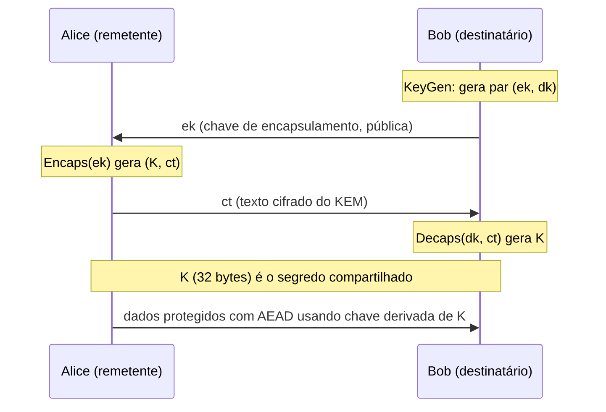
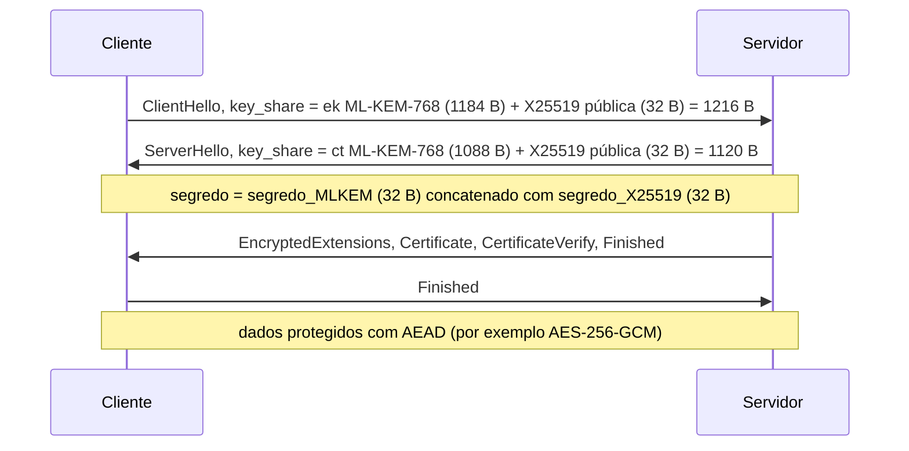
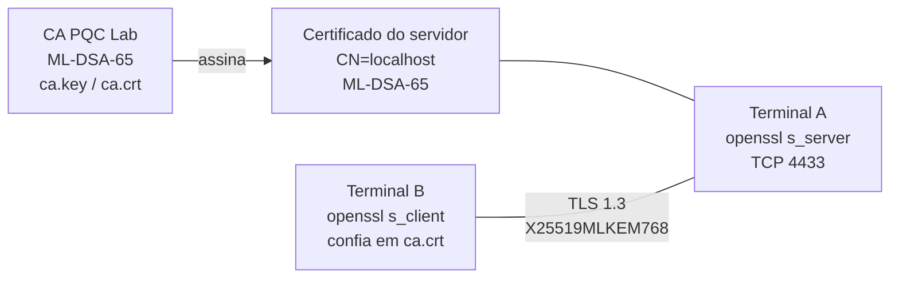

# Laboratório 3: Criptografia Pós-Quântica com OpenSSL 3.5

- **Instituição:** Universidade de Brasília (UnB)
- **Departamento:** Departamento de Engenharia Elétrica (ENE)
- **Curso:** Engenharia de Redes de Comunicação e Mestrado Profissional em Engenharia Elétrica (PPEE)
- **Disciplina:** ENE0021 - Tópicos em Redes de Comunicação 3 (oferta conjunta com PPEE2017 - Tópicos em Segurança Cibernética 5)
- **Professor responsável:** Prof. Dr. Laerte Peotta de Melo
- **Tema:** Troca de chaves e assinaturas pós-quânticas (ML-KEM, ML-DSA e SLH-DSA), PKI de laboratório e TLS 1.3 híbrido

> **Pré-requisito:** Laboratórios 1 (criptografia simétrica) e 2 (criptografia assimétrica), Aula 6 (criptografia assimétrica e hash) e Aula 7 (certificados, PKI e criptografia pós-quântica).

---

## 1. Objetivos

Ao final do laboratório, o estudante será capaz de:

1. Explicar por que RSA, *Diffie-Hellman* (DH) e curvas elípticas são vulneráveis a um computador quântico criptograficamente relevante, e por que a cifra simétrica e o *hash* são afetados de forma bem menos severa.
2. Distinguir um mecanismo de encapsulamento de chave (*Key Encapsulation Mechanism*, KEM) de uma cifragem assimétrica tradicional.
3. Executar, com o OpenSSL 3.5, o encapsulamento e o desencapsulamento de um segredo compartilhado com **ML-KEM**.
4. Gerar e verificar assinaturas digitais com **ML-DSA** e **SLH-DSA**.
5. Construir uma autoridade certificadora (*Certification Authority*, CA) de laboratório com chaves ML-DSA e emitir um certificado X.509 de servidor.
6. Estabelecer uma sessão TLS 1.3 com troca de chaves híbrida **X25519MLKEM768** e comprovar o grupo negociado.
7. Medir e comparar o custo em bytes (chaves, assinaturas, certificados e mensagens do *handshake*) entre algoritmos clássicos e pós-quânticos.

---

## 2. Fundamentação Teórica

### 2.1 A ameaça quântica

Dois algoritmos quânticos orientam todo o planejamento da migração:

| Algoritmo | Efeito | Alvo | Consequência prática |
| :--- | :--- | :--- | :--- |
| **Shor** (1994) | Fatoração e logaritmo discreto em tempo polinomial | RSA, DH, DSA, ECDH, ECDSA, EdDSA | Quebra total. Os parâmetros maiores não resolvem; é preciso trocar de algoritmo |
| **Grover** (1996) | Busca em tempo da raiz quadrada do espaço de chaves | AES, ChaCha20, SHA-2, SHA-3 | Reduz à metade, em bits, a segurança efetiva. AES-256 permanece adequado |

Um computador quântico capaz de executar o algoritmo de Shor sobre chaves reais ainda não existe. O risco já é presente por causa do ataque ***harvest now, decrypt later*** (coletar agora, decifrar depois): um adversário grava hoje o tráfego cifrado e o decifra quando dispuser do computador quântico. Por isso, a **troca de chaves** (sigilo de longo prazo) é migrada antes das **assinaturas** (que só importam no momento da verificação).

### 2.2 Padrões do NIST (agosto de 2024)

O *National Institute of Standards and Technology* (NIST) concluiu o primeiro ciclo de padronização com três normas federais:

| Norma | Algoritmo | Origem (nome do concurso) | Função | Base matemática |
| :--- | :--- | :--- | :--- | :--- |
| [**FIPS 203**](https://csrc.nist.gov/pubs/fips/203/final) | **ML-KEM** (*Module-Lattice-Based KEM*) | CRYSTALS-Kyber | Estabelecimento de chave (KEM) | Reticulados modulares (*Module-LWE*) |
| [**FIPS 204**](https://csrc.nist.gov/pubs/fips/204/final) | **ML-DSA** (*Module-Lattice-Based Digital Signature Algorithm*) | CRYSTALS-Dilithium | Assinatura digital | Reticulados modulares (*Module-LWE* e *Module-SIS*) |
| [**FIPS 205**](https://csrc.nist.gov/pubs/fips/205/final) | **SLH-DSA** (*Stateless Hash-Based Digital Signature Algorithm*) | SPHINCS+ | Assinatura digital | Apenas funções *hash* |

Observações importantes:

- **Kyber e ML-KEM não são idênticos.** O ML-KEM é derivado do Kyber (rodada 3) com alterações no padrão final. Implementações e roteiros antigos que usam os nomes `kyber512`, `kyber768` e `OQS-Kyber512x25519` **não interoperam** com o ML-KEM.
- O **Falcon** (futuro FN-DSA, FIPS 206) e o **HQC** (KEM baseado em códigos, selecionado pelo NIST em 2025 como alternativa ao ML-KEM) seguem em processo de padronização e não estão disponíveis no OpenSSL 3.5.
- O NIST indica a desativação dos algoritmos de chave pública clássicos de 112 bits até 2030 e a proibição até 2035 (documento NIST IR 8547, em fase de minuta na data de redação deste roteiro). O prazo é a razão de existir a prática de **agilidade criptográfica** (*crypto agility*).

### 2.3 O que mudou no OpenSSL

| Versão | Situação do suporte pós-quântico |
| :--- | :--- |
| OpenSSL 3.0 a 3.4 | Nenhum algoritmo pós-quântico nativo. Era necessário o `oqs-provider` (projeto *Open Quantum Safe*) ou o fork `OQS-OpenSSL` |
| **OpenSSL 3.5** (abril de 2025, versão LTS) | **ML-KEM, ML-DSA e SLH-DSA nativos** no provedor `default`, com suporte em TLS 1.3, X.509 e nas ferramentas de linha de comando. Grupo híbrido **X25519MLKEM768** habilitado por padrão no cliente |

Consequência para este laboratório: **não é mais necessário compilar o `liboqs` nem o `oqs-provider`**. O roteiro anterior (fork `OQS-OpenSSL`, grupos `kyber512` e `OQS-Kyber512x25519`) foi descontinuado.

### 2.4 KEM versus cifragem de chave pública

Em RSA-OAEP, o remetente escolhe o segredo e o cifra com a chave pública do destinatário. Em um **KEM**, o remetente executa uma única operação, o **encapsulamento**, que **gera** o segredo e o seu texto cifrado ao mesmo tempo:



As três operações do ML-KEM:

1. **KeyGen:** a partir de uma semente de 64 bytes, deriva-se uma matriz pública **A** (expandida por SHAKE128 a partir de uma semente pública), um vetor secreto **s** e um vetor de erro **e**, ambos de coeficientes pequenos. A chave pública contém **t = A·s + e** (mais a semente de **A**). Recuperar **s** a partir de **t** e **A** é o problema *Module-LWE* (*Learning With Errors*), considerado difícil inclusive para computadores quânticos.
2. **Encaps:** Alice sorteia uma mensagem aleatória de 32 bytes, deriva dela o segredo **K** e a aleatoriedade usada para cifrar a mensagem sob a chave de Bob, produzindo **ct**. A transformação de Fujisaki-Okamoto torna o esquema seguro contra ataques de texto cifrado escolhido (IND-CCA2).
3. **Decaps:** Bob usa **s** para recuperar a mensagem, **recifra** e compara o resultado com **ct**. Se coincidir, devolve **K**. Se **ct** foi adulterado, devolve um valor pseudoaleatório derivado de um segredo interno (**rejeição implícita**): **não há erro visível**, apenas um segredo diferente. O experimento da Seção 4.3 mostra esse comportamento.

Parâmetros do ML-KEM (todos geram um segredo de **32 bytes**):

| Conjunto | Nível de segurança (NIST) | Chave pública (`ek`) | Texto cifrado (`ct`) |
| :--- | :---: | ---: | ---: |
| ML-KEM-512 | 1 (equivalente a AES-128) | 800 bytes | 768 bytes |
| ML-KEM-768 | 3 (equivalente a AES-192) | 1184 bytes | 1088 bytes |
| ML-KEM-1024 | 5 (equivalente a AES-256) | 1568 bytes | 1568 bytes |

### 2.5 Assinaturas: ML-DSA e SLH-DSA

- **ML-DSA** usa o paradigma *Fiat-Shamir com abortos* sobre reticulados modulares. Tem chaves e assinaturas de poucos kilobytes e boa velocidade. É a escolha geral recomendada. Variantes: ML-DSA-44, ML-DSA-65 e ML-DSA-87 (níveis 2, 3 e 5).
- **SLH-DSA** baseia-se em uma hipertrilha de Merkle e na estrutura FORS, e depende somente da segurança da função *hash* (SHA-2 ou SHAKE). Suas chaves públicas são minúsculas (32 a 64 bytes), mas as assinaturas são grandes (de 7,8 KB a quase 50 KB). O sufixo **`s`** (*small*) indica assinatura menor e geração lenta; **`f`** (*fast*) indica geração rápida e assinatura maior. É uma opção conservadora, pois não depende de problemas de reticulados.

### 2.6 Troca de chaves híbrida no TLS 1.3

O grupo **X25519MLKEM768** (identificador `0x11EC`, 4588 em decimal) executa **duas** trocas de chaves em paralelo no mesmo *handshake* do [**TLS 1.3 (RFC 8446)**](https://datatracker.ietf.org/doc/html/rfc8446) e concatena os dois segredos antes de entrar no escalonamento de chaves:



A razão da **hibridização** é prudencial: se um defeito matemático ou de implementação for descoberto no ML-KEM (um algoritmo jovem), o X25519 ainda protege contra adversários clássicos; se um computador quântico existir, o ML-KEM protege contra ele. O atacante precisa quebrar **os dois**. A especificação do grupo está em *draft* do IETF (`draft-ietf-tls-ecdhe-mlkem`) e já é implantada em navegadores, no OpenSSL 3.5 e em grandes provedores de nuvem.

A **autenticação** do servidor no TLS (certificado e `CertificateVerify`) é independente da troca de chaves: continua clássica na maior parte da Internet. Neste laboratório, será usada também uma cadeia ML-DSA para observar o impacto no tamanho do *handshake*.

### 2.7 Ficha técnica

| Campo | Valor |
| :--- | :--- |
| Ferramenta | OpenSSL 3.5 ou superior (provedor `default`) |
| Camada | Aplicação (TLS sobre TCP) |
| Porta de teste | TCP 4433 (servidor `s_server`) |
| Mensagens relevantes | `ClientHello`, `ServerHello`, `EncryptedExtensions`, `Certificate`, `CertificateVerify`, `Finished` |
| Normas | FIPS 203, FIPS 204, FIPS 205, [RFC 8446](https://datatracker.ietf.org/doc/html/rfc8446) (TLS 1.3), [RFC 5280](https://datatracker.ietf.org/doc/html/rfc5280) (X.509) |

---

## 3. Topologia e Cenário

Todo o experimento ocorre em **um único computador** (Kali Linux, outra distribuição Linux ou WSL), com dois terminais: o terminal **A** representa o servidor e o terminal **B** representa o cliente. Os nomes Alice e Bob são usados nos experimentos de KEM e de assinatura.



| Elemento | Nome ou valor | Função |
| :--- | :--- | :--- |
| Diretório de trabalho | `~/lab-pqc` | Todos os arquivos gerados |
| Servidor | `localhost`, TCP 4433 | `openssl s_server` com certificado ML-DSA-65 |
| Cliente | `localhost` | `openssl s_client` com `-CAfile ca.crt` |
| CA do laboratório | `CN=CA PQC Lab` | Autoridade autoassinada com ML-DSA-65 |

---

## 4. Roteiro Prático

### 4.1 Preparação e verificação do ambiente

```bash
# Cria o diretório de trabalho e entra nele
mkdir -p ~/lab-pqc && cd ~/lab-pqc

# Mostra a versão do OpenSSL no PATH; é necessário 3.5 ou superior
openssl version
```

Saída esperada (a revisão pode variar, desde que seja 3.5.x ou superior):

```text
OpenSSL 3.5.7 9 Jun 2026 (Library: OpenSSL 3.5.7 9 Jun 2026)
```

Se a versão for **inferior a 3.5**, o comando `genpkey -algorithm ML-KEM-768` falha com erro de algoritmo desconhecido ou não suportado (o texto exato varia conforme a versão). Há duas alternativas.

**Opção A: compilar o OpenSSL 3.5 em diretório separado** (não substitui o OpenSSL do sistema). Baixe o arquivo `openssl-3.5.x.tar.gz` mais recente da série 3.5 em <https://github.com/openssl/openssl/releases> e execute:

```bash
# Dependências de compilação
sudo apt update && sudo apt install -y build-essential perl

# Descompacta e configura com prefixo próprio (substitua 3.5.x pela versão baixada)
tar xzf openssl-3.5.x.tar.gz && cd openssl-3.5.x
./Configure --prefix=$HOME/openssl-3.5 --openssldir=$HOME/openssl-3.5/ssl

# Compila em paralelo e instala apenas binários e bibliotecas (sem documentação)
make -j$(nproc)
make install_sw

# Usa o novo binário e a nova biblioteca nesta sessão de terminal
export PATH=$HOME/openssl-3.5/bin:$PATH
export LD_LIBRARY_PATH=$HOME/openssl-3.5/lib64:$HOME/openssl-3.5/lib:$LD_LIBRARY_PATH
openssl version
```

**Opção B:** usar um contêiner ou uma distribuição que já traga o OpenSSL 3.5 (por exemplo, uma imagem recente). O procedimento da Opção A não foi executado no ambiente de elaboração deste roteiro (os demais comandos foram); em caso de falha na compilação, registre a mensagem de erro no relatório.

> **Observação:** todos os comandos a seguir foram executados e validados com o OpenSSL 3.5.7. O formato de algumas linhas de saída (por exemplo, a ordem dos campos) pode variar entre revisões.

### 4.2 Inventário de algoritmos pós-quânticos

```bash
# Algoritmos de KEM (encapsulamento de chave) e grupos híbridos de TLS
openssl list -kem-algorithms

# Algoritmos de assinatura (filtra apenas os pós-quânticos)
openssl list -signature-algorithms | grep -E "ML-DSA|SLH-DSA"

# Grupos de troca de chaves disponíveis no TLS 1.3
openssl list -tls-groups
```

Trecho esperado de `list -kem-algorithms`:

```text
  { 2.16.840.1.101.3.4.4.1, id-alg-ml-kem-512, ML-KEM-512, MLKEM512 } @ default
  { 2.16.840.1.101.3.4.4.2, id-alg-ml-kem-768, ML-KEM-768, MLKEM768 } @ default
  { 2.16.840.1.101.3.4.4.3, id-alg-ml-kem-1024, ML-KEM-1024, MLKEM1024 } @ default
  X25519MLKEM768 @ default
  X448MLKEM1024 @ default
  SecP256r1MLKEM768 @ default
  SecP384r1MLKEM1024 @ default
```

Leitura da saída: cada linha traz o **OID** (*Object Identifier*), os nomes aceitos e o provedor (`@ default`). As quatro últimas entradas são **KEMs híbridos de TLS** (clássico mais ML-KEM). O ML-DSA aparece com os OIDs `2.16.840.1.101.3.4.3.17`, `.18` e `.19` (níveis 44, 65 e 87), e o SLH-DSA com 12 variantes (`SLH-DSA-SHA2-128s` até `SLH-DSA-SHAKE-256f`).

### 4.3 ML-KEM: encapsulamento e desencapsulamento

Bob gera o par de chaves de KEM e entrega a chave pública a Alice.

```bash
# Bob: gera a chave privada ML-KEM-768 (formato PKCS#8, PEM)
openssl genpkey -algorithm ML-KEM-768 -out bob_kem.key

# Bob: extrai a chave pública (chave de encapsulamento, ek)
openssl pkey -in bob_kem.key -pubout -out bob_kem.pub

# Protege a chave privada: somente o dono lê e escreve
chmod 600 bob_kem.key
```

Alice encapsula: gera, em uma só operação, o segredo e o texto cifrado do KEM.

```bash
# Alice: -encap gera o segredo (-secret) e o texto cifrado do KEM (-out)
openssl pkeyutl -encap -pubin -inkey bob_kem.pub -out ct.bin -secret ss_alice.bin
```

Bob desencapsula com a chave privada:

```bash
# Bob: recupera o segredo a partir de ct.bin
openssl pkeyutl -decap -inkey bob_kem.key -in ct.bin -secret ss_bob.bin

# Compara os dois segredos e mostra os tamanhos
cmp ss_alice.bin ss_bob.bin && echo "SEGREDOS IGUAIS"
ls -l ct.bin ss_alice.bin ss_bob.bin
xxd -p ss_alice.bin | tr -d '\n'; echo
```

Saída esperada (o conteúdo do segredo será **diferente** a cada execução; apenas os tamanhos são fixos):

```text
SEGREDOS IGUAIS
-rw-r--r-- 1 aluno aluno 1088 ct.bin
-rw-r--r-- 1 aluno aluno   32 ss_alice.bin
-rw-r--r-- 1 aluno aluno   32 ss_bob.bin
523f4cb1974b20e033346fa63c489be234702a227c7a0e4b41987c82a5ba1de1
```

Explicação campo a campo: `ct.bin` tem **1088 bytes** (o texto cifrado do ML-KEM-768); o segredo compartilhado tem **32 bytes (256 bits)**, adequado para derivar uma chave AES-256. O arquivo `ss_alice.bin` nunca trafega pela rede: apenas `bob_kem.pub` e `ct.bin` são públicos.

#### 4.3.1 Inspeção da chave

```bash
# Mostra a estrutura da chave privada (semente e chave expandida)
openssl pkey -in bob_kem.key -noout -text | head -8

# Mostra o início da chave pública (ek)
openssl pkey -in bob_kem.pub -pubin -noout -text | head -4
```

```text
ML-KEM-768 Private-Key:
seed:
    31:0c:95:b5:69:7d:71:04:7d:07:df:5d:5f:46:24:
    ...
dk:
    1f:85:8c:9f:68:64:92:9b:4c:0c:c5:8c:04:32:c8:
ML-KEM-768 Public-Key:
ek:
    48:68:01:e2:b2:cf:a3:b5:1a:5e:25:4d:a6:c8:44:
```

O OpenSSL 3.5 grava, por padrão, a **semente** (64 bytes) e a chave de decapsulamento expandida (`dk`, 2400 bytes). A semente basta para reconstruir a chave inteira. Para gravar somente a semente:

```bash
openssl genpkey -algorithm ML-KEM-768 -provparam ml-kem.output_formats=seed-only -out bob_seed.key
ls -l bob_kem.key bob_seed.key
```

O arquivo PEM completo tem cerca de 3,5 KB e o de semente apenas, cerca de 176 bytes. A segunda forma é compacta, mas obriga a regenerar a chave expandida a cada uso.

#### 4.3.2 Experimento: texto cifrado adulterado (rejeição implícita)

```bash
# Altera 1 bit do byte 100 do texto cifrado
python3 - <<'EOF'
b = bytearray(open('ct.bin','rb').read())
b[100] ^= 1
open('ct_bad.bin','wb').write(b)
EOF

# Bob tenta desencapsular o texto cifrado adulterado
openssl pkeyutl -decap -inkey bob_kem.key -in ct_bad.bin -secret ss_bad.bin
echo "código de saída: $?"
xxd -p ss_bad.bin | tr -d '\n'; echo
xxd -p ss_bob.bin | tr -d '\n'; echo
```

```text
código de saída: 0
d85348b5e5a6094fdf7008cc57c4e407328b2818b8b4027050786b645f0b8938
523f4cb1974b20e033346fa63c489be234702a227c7a0e4b41987c82a5ba1de1
```

O comando **termina sem erro** (código 0) e entrega um segredo **diferente**. Essa é a **rejeição implícita** do ML-KEM: o desencapsulamento nunca sinaliza falha, o que evita que o atacante use mensagens de erro como oráculo. A falha só se manifesta mais adiante, quando as duas partes tentarem usar chaves distintas e a autenticação (AEAD ou `Finished` do TLS) rejeitar a comunicação.

### 4.4 ML-DSA e SLH-DSA: assinaturas

```bash
# Cria uma mensagem de teste
echo "Mensagem de teste PQC" > msg.txt

# Gera os pares de chaves
openssl genpkey -algorithm ML-DSA-65 -out mldsa.key
openssl pkey -in mldsa.key -pubout -out mldsa.pub
openssl genpkey -algorithm SLH-DSA-SHA2-128s -out slh.key
openssl pkey -in slh.key -pubout -out slh.pub

# Assina com ML-DSA-65 (-rawin: a mensagem inteira é assinada, sem pré-hash externo)
openssl pkeyutl -sign -inkey mldsa.key -rawin -in msg.txt -out mldsa.sig

# Verifica a assinatura
openssl pkeyutl -verify -pubin -inkey mldsa.pub -rawin -in msg.txt -sigfile mldsa.sig

# Repete com SLH-DSA-SHA2-128s
openssl pkeyutl -sign -inkey slh.key -rawin -in msg.txt -out slh.sig
openssl pkeyutl -verify -pubin -inkey slh.pub -rawin -in msg.txt -sigfile slh.sig

# Tamanho das assinaturas
wc -c mldsa.sig slh.sig
```

```text
Signature Verified Successfully
Signature Verified Successfully
  3309 mldsa.sig
  7856 slh.sig
 11165 total
```

**Teste de adulteração:** acrescente um byte à mensagem e verifique novamente.

```bash
echo "x" >> msg.txt
openssl pkeyutl -verify -pubin -inkey mldsa.pub -rawin -in msg.txt -sigfile mldsa.sig
echo "código de saída: $?"
```

```text
...ML-DSA-65 digest_verify:
Signature Verification Failure
código de saída: 1
```

Diferentemente do KEM, a verificação de assinatura **sinaliza falha** com código de saída 1. Restaure a mensagem original antes de seguir: `echo "Mensagem de teste PQC" > msg.txt`.

> **Observação:** o `openssl dgst -sign mldsa.key -out assinatura msg.txt` também funciona com ML-DSA e produz uma assinatura equivalente, sem a opção `-sha256`: o ML-DSA já incorpora o *hash* internamente.

### 4.5 Tabela comparativa de tamanhos

Execute o laço a seguir e preencha a tabela do relatório. Ele mede o tamanho da **chave pública** codificada em DER (formato `SubjectPublicKeyInfo`, usado em certificados) e da **assinatura** ou do **texto cifrado** de cada algoritmo.

```bash
# Assinaturas: chave pública (DER) e assinatura
for alg in RSA ED25519 ML-DSA-44 ML-DSA-65 ML-DSA-87 SLH-DSA-SHA2-128s SLH-DSA-SHA2-128f SLH-DSA-SHA2-256s; do
  if [ "$alg" = RSA ]; then
    openssl genpkey -algorithm RSA -pkeyopt rsa_keygen_bits:2048 -out k.key 2>/dev/null
    openssl dgst -sha256 -sign k.key -out k.sig msg.txt
  else
    openssl genpkey -algorithm $alg -out k.key
    openssl pkeyutl -sign -inkey k.key -rawin -in msg.txt -out k.sig
  fi
  echo "$alg chave_publica=$(openssl pkey -in k.key -pubout -outform DER | wc -c) assinatura=$(wc -c < k.sig)"
done

# KEMs: chave pública (DER) e texto cifrado
for alg in ML-KEM-512 ML-KEM-768 ML-KEM-1024; do
  openssl genpkey -algorithm $alg -out k.key
  openssl pkey -in k.key -pubout -out k.pub
  openssl pkeyutl -encap -pubin -inkey k.pub -out c.bin -secret s.bin
  echo "$alg chave_publica=$(openssl pkey -in k.pub -pubin -pubout -outform DER | wc -c) texto_cifrado=$(wc -c < c.bin) segredo=$(wc -c < s.bin)"
done
```

Valores obtidos na validação (chave pública em DER, que inclui cerca de 20 bytes de cabeçalho ASN.1):

| Algoritmo | Tipo | Chave pública (DER) | Assinatura ou texto cifrado | Observação |
| :--- | :--- | ---: | ---: | :--- |
| RSA-2048 | Assinatura | 294 bytes | 256 bytes | Clássico, vulnerável a Shor |
| ECDSA P-256 | Assinatura | 91 bytes | cerca de 71 bytes | Clássico, vulnerável a Shor |
| Ed25519 | Assinatura | 44 bytes | 64 bytes | Clássico, vulnerável a Shor |
| ML-DSA-44 | Assinatura | 1334 bytes | 2420 bytes | Nível 2 |
| **ML-DSA-65** | Assinatura | **1974 bytes** | **3309 bytes** | Nível 3 (uso geral) |
| ML-DSA-87 | Assinatura | 2614 bytes | 4627 bytes | Nível 5 |
| SLH-DSA-SHA2-128s | Assinatura | 50 bytes | 7856 bytes | Pequena, geração lenta |
| SLH-DSA-SHA2-128f | Assinatura | 50 bytes | 17088 bytes | Rápida, assinatura maior |
| SLH-DSA-SHA2-256s | Assinatura | 82 bytes | 29792 bytes | Nível 5 |
| X25519 (ECDH) | Troca de chaves | 44 bytes | 32 bytes (parte do par) | Clássico, vulnerável a Shor |
| ML-KEM-512 | KEM | 822 bytes | 768 bytes | Nível 1 |
| **ML-KEM-768** | KEM | **1206 bytes** | **1088 bytes** | Nível 3 (padrão no TLS) |
| ML-KEM-1024 | KEM | 1590 bytes | 1568 bytes | Nível 5 |

Conclusão operacional: os algoritmos pós-quânticos têm desempenho computacional comparável ao dos clássicos, mas **chaves e assinaturas de 10 a 100 vezes maiores** (ou mais, no SLH-DSA). O custo recai sobre a largura de banda, o tamanho de certificados e a fragmentação de pacotes.

### 4.6 PKI de laboratório com ML-DSA-65

Será construída uma cadeia de dois níveis: a CA autoassinada (`CN=CA PQC Lab`) e o certificado do servidor (`CN=localhost`), ambos com chaves ML-DSA-65. O fluxo é o mesmo do roteiro de PKI com RSA ou ECDSA: apenas o algoritmo muda.

```bash
# 1. Chave privada e certificado autoassinado da CA
openssl genpkey -algorithm ML-DSA-65 -out ca.key
openssl req -x509 -new -key ca.key -days 365 -subj "/CN=CA PQC Lab" \
  -addext "basicConstraints=critical,CA:TRUE" \
  -addext "keyUsage=critical,keyCertSign,cRLSign" \
  -out ca.crt

# 2. Chave privada e requisição de certificado (CSR) do servidor
openssl genpkey -algorithm ML-DSA-65 -out srv.key
openssl req -new -key srv.key -subj "/CN=localhost" -out srv.csr

# 3. Arquivo de extensões do certificado do servidor
cat > ext.cnf <<'EOF'
subjectAltName=DNS:localhost,IP:127.0.0.1
keyUsage=critical,digitalSignature
extendedKeyUsage=serverAuth
basicConstraints=CA:FALSE
EOF

# 4. A CA assina a requisição e emite srv.crt (validade de 90 dias)
openssl x509 -req -in srv.csr -CA ca.crt -CAkey ca.key -CAcreateserial \
  -days 90 -extfile ext.cnf -out srv.crt

# 5. Verifica a cadeia e inspeciona o certificado
openssl verify -CAfile ca.crt srv.crt
openssl x509 -in srv.crt -noout -text | grep -E "Signature Algorithm|Public Key Algorithm|Issuer|Subject:"
openssl x509 -in srv.crt -outform DER | wc -c
```

Saída esperada:

```text
Certificate request self-signature ok
subject=CN=localhost
srv.crt: OK
        Signature Algorithm: ML-DSA-65
        Issuer: CN=CA PQC Lab
        Subject: CN=localhost
            Public Key Algorithm: ML-DSA-65
    Signature Algorithm: ML-DSA-65
5572
```

Explicação: o certificado do servidor ocupa **5572 bytes em DER**, porque contém uma chave pública ML-DSA-65 (1952 bytes) e uma assinatura ML-DSA-65 da CA (3309 bytes). Para efeito de comparação, um certificado autoassinado RSA-2048 ocupa cerca de 781 bytes e um ECDSA P-256 cerca de 385 bytes. Em uma cadeia completa (servidor mais CA intermediária mais *Signed Certificate Timestamps*), os certificados pós-quânticos podem superar 15 KB.

> **Limitação do laboratório:** uma CA de laboratório não é confiável para navegadores. A confiança é concedida apenas ao cliente de teste por meio de `-CAfile ca.crt`. A segurança real depende da proteção da chave `ca.key`, que nunca deve ser compartilhada.

### 4.7 Sessão TLS 1.3 com troca de chaves híbrida

**Terminal A (servidor):**

```bash
cd ~/lab-pqc

# Servidor TLS 1.3 com certificado ML-DSA-65.
# -groups: grupos de troca de chaves aceitos (híbrido preferido, X25519 como alternativa)
# -www: responde a "GET /" com uma página de status da conexão
openssl s_server -accept 4433 -cert srv.crt -key srv.key -tls1_3 -www \
  -groups X25519MLKEM768:X25519
```

**Terminal B (cliente):**

```bash
cd ~/lab-pqc

# Cliente: força o grupo híbrido e exibe o resumo da conexão
echo | openssl s_client -connect localhost:4433 -CAfile ca.crt -tls1_3 \
  -groups X25519MLKEM768 -brief
```

Saída esperada:

```text
CONNECTION ESTABLISHED
Protocol version: TLSv1.3
Ciphersuite: TLS_AES_256_GCM_SHA384
Peer certificate: CN=localhost
Hash used: UNDEF
Signature type: mldsa65
Verification: OK
Negotiated TLS1.3 group: X25519MLKEM768
DONE
```

Interpretação campo a campo:

| Campo | Valor | Significado |
| :--- | :--- | :--- |
| `Protocol version` | `TLSv1.3` | Versão negociada ([RFC 8446](https://datatracker.ietf.org/doc/html/rfc8446)) |
| `Ciphersuite` | `TLS_AES_256_GCM_SHA384` | Cifra **simétrica** AEAD e função *hash* do escalonamento de chaves. Permanece segura contra o algoritmo de Grover com chave de 256 bits |
| `Signature type` | `mldsa65` | O servidor autenticou-se com **assinatura ML-DSA-65** no `CertificateVerify` |
| `Hash used` | `UNDEF` | O ML-DSA incorpora o *hash* internamente; não há *hash* externo |
| `Verification` | `OK` | O certificado do servidor foi validado até `ca.crt` |
| `Negotiated TLS1.3 group` | `X25519MLKEM768` | A troca de chaves foi **híbrida** (X25519 mais ML-KEM-768) |

#### 4.7.1 Variações para análise

Repita o cliente com as variações abaixo e registre o resultado de cada uma.

```bash
# (a) Apenas X25519: sem proteção pós-quântica na troca de chaves
echo | openssl s_client -connect localhost:4433 -CAfile ca.crt -tls1_3 -groups X25519 -brief

# (b) Sem a opção -groups: comportamento padrão do OpenSSL 3.5
echo | openssl s_client -connect localhost:4433 -CAfile ca.crt -tls1_3 -brief
```

Resultados observados: em **(a)**, o resumo mostra `Peer Temp Key: X25519, 253 bits` (sem componente pós-quântico) e o certificado ML-DSA continua sendo aceito, o que demonstra que **troca de chaves e autenticação são independentes**; em **(b)**, o cliente padrão do OpenSSL 3.5 já oferece e negocia `X25519MLKEM768`, ou seja, o **comportamento padrão passou a ser híbrido**.

```bash
# (c) Apenas ML-KEM-768 puro: o servidor do Terminal A não o oferece
echo | openssl s_client -connect localhost:4433 -CAfile ca.crt -tls1_3 -groups MLKEM768 -brief
```

Resultado observado em **(c)**:

```text
...error:0A000410:SSL routines:ssl3_read_bytes:ssl/tls alert handshake failure...SSL alert number 40
```

A falha ocorre porque **não há grupo em comum**: o cliente oferece só `MLKEM768` e o servidor só aceita `X25519MLKEM768` e `X25519`. O alerta `handshake_failure` (número 40) é o diagnóstico típico de incompatibilidade de parâmetros. Para testar o ML-KEM puro, reinicie o servidor com `-groups MLKEM768` (nesse caso, o cliente (a) falhará pelo mesmo motivo). Em produção, o ML-KEM puro é pouco usado; a recomendação corrente é o modo híbrido.

### 4.8 Análise do *handshake*: custo em bytes

```bash
# Exibe o tamanho de cada mensagem do handshake (-msg)
echo | openssl s_client -connect localhost:4433 -CAfile ca.crt -tls1_3 \
  -groups X25519MLKEM768 -msg 2>&1 | grep -E "Handshake \[length"
```

Saída (os tamanhos estão em **hexadecimal**):

```text
>>> TLS 1.3, Handshake [length 0573], ClientHello
<<< TLS 1.3, Handshake [length 04ba], ServerHello
<<< TLS 1.3, Handshake [length 0006], EncryptedExtensions
<<< TLS 1.3, Handshake [length 15d1], Certificate
<<< TLS 1.3, Handshake [length 0cf5], CertificateVerify
<<< TLS 1.3, Handshake [length 0034], Finished
```

Para comparar com o *handshake* clássico, inicie um servidor com certificado ECDSA P-256 e grupo X25519 em outra porta:

```bash
# Terminal A: servidor clássico na porta 4434
openssl req -x509 -newkey ec -pkeyopt ec_paramgen_curve:P-256 -nodes -keyout e.key \
  -subj "/CN=localhost" -days 90 -out e.crt
openssl s_server -accept 4434 -cert e.crt -key e.key -tls1_3 -www -groups X25519

# Terminal B: cliente clássico
echo | openssl s_client -connect localhost:4434 -tls1_3 -groups X25519 -msg 2>&1 | grep -E "Handshake \[length"
```

Tamanhos medidos na validação (convertidos para decimal):

| Mensagem | Clássico (X25519 + ECDSA P-256) | Pós-quântico (X25519MLKEM768 + ML-DSA-65) | Fator |
| :--- | ---: | ---: | ---: |
| `ClientHello` | 219 bytes | 1395 bytes | 6,4 vezes |
| `ServerHello` | 122 bytes | 1210 bytes | 9,9 vezes |
| `Certificate` | 398 bytes | 5585 bytes | 14,0 vezes |
| `CertificateVerify` | 80 bytes | 3317 bytes | 41,5 vezes |

Interpretação:

- O `key_share` do cliente tem **1216 bytes** (1184 da chave pública ML-KEM-768 mais 32 do X25519), confirmável com a opção `-trace` (`key_exchange: (len=1216)`). O `key_share` do servidor tem **1120 bytes** (1088 do texto cifrado mais 32 do X25519).
- O `ClientHello` de 1395 bytes **ultrapassa a MTU típica de um pacote** (cerca de 1500 bytes menos cabeçalhos): em redes com *middleboxes* mal implementados que não remontam o `ClientHello` fragmentado em segmentos TCP, a conexão pode falhar. Esse é um dos motivos de a implantação em larga escala ter sido gradual.
- O `CertificateVerify` cresce porque contém a assinatura ML-DSA-65 (3309 bytes).

#### 4.8.1 Atividade opcional: captura no Wireshark

1. Inicie o servidor do Terminal A com a opção `-keylogfile segredos.log` (grava os segredos de sessão).
2. Capture a interface de *loopback* no Wireshark com o filtro `tcp.port == 4433`.
3. Execute o cliente do Terminal B.
4. Em *Edit > Preferences > Protocols > TLS*, aponte *(Pre)-Master-Secret log filename* para `segredos.log`.
5. Aplique o filtro `tls.handshake.type == 1` e abra a extensão `key_share` do `ClientHello`: o grupo aparecerá como `X25519MLKEM768 (0x11ec)` e o campo de troca de chave terá 1216 bytes.

> **Observação:** o suporte do Wireshark ao grupo híbrido depende da versão instalada. Versões antigas exibem o grupo apenas como identificador numérico `4588`. Registre a versão utilizada.

---

## 5. Verificação e Diagnóstico

| Sintoma | Causa provável | Correção |
| :--- | :--- | :--- |
| Erro de algoritmo desconhecido ou não suportado ao gerar chave ML-KEM ou ML-DSA | OpenSSL anterior a 3.5 no `PATH` | Executar `openssl version`; usar o OpenSSL 3.5 compilado (Seção 4.1) e conferir o `PATH` e o `LD_LIBRARY_PATH` |
| `openssl list -kem-algorithms` não mostra `ML-KEM` | Biblioteca antiga carregada por engano | `ldd $(which openssl)` e `echo $LD_LIBRARY_PATH` |
| `ssl/tls alert handshake failure` (alerta 40) | Nenhum grupo em comum entre cliente e servidor | Alinhar as opções `-groups` de cliente e servidor |
| `Verify return code: 18` ou `20` (certificado autoassinado ou emissor desconhecido) | Cliente sem a CA do laboratório | Incluir `-CAfile ca.crt` |
| `Address already in use` | Porta 4433 ocupada por servidor anterior | Encerrar o processo (`Ctrl+C`) ou usar outra porta |
| `Verification failure` com `ML-DSA` | Mensagem ou assinatura alterada, ou chave pública errada | Conferir se o `-in` e o `-sigfile` correspondem ao par de chaves |
| Nome de arquivo ou caminho alterado no Windows com Git Bash | Conversão automática de caminhos | Usar `export MSYS_NO_PATHCONV=1` ou executar em WSL ou Linux |

---

## 6. Segurança e Boas Práticas

1. **Priorize a troca de chaves.** O risco de *harvest now, decrypt later* afeta a confidencialidade de dados de longa vida útil. A migração de assinaturas é menos urgente, mas depende de ciclos longos de renovação de PKI.
2. **Use o modo híbrido** em produção. O ML-KEM é padrão recente; a combinação com X25519 mantém a segurança mesmo se o componente pós-quântico apresentar falha.
3. **Mantenha a criptografia simétrica forte:** AES-256 e SHA-384 ou superior continuam adequados no cenário quântico.
4. **Proteja as chaves privadas** (`chmod 600`). Chaves pós-quânticas não são imunes ao vazamento por falha operacional.
5. **Pratique agilidade criptográfica:** inventarie onde RSA, DH e ECC são usados (TLS, VPN, assinatura de código, S/MIME, PKI) e projete sistemas que permitam trocar de algoritmo sem reescrever o protocolo.
6. **Esteja atento a ataques de implementação**: canais laterais (*side-channels*), aleatoriedade defeituosa e ataques de injeção de falhas atingem também os algoritmos pós-quânticos. Use bibliotecas mantidas e atualizadas.
7. **Limitação deste laboratório:** a CA é de laboratório e não oferece revogação, e o OpenSSL utilizado não é, necessariamente, um módulo validado pelo FIPS 140-3. Em ambientes regulados, verifique o certificado de validação do módulo criptográfico.

---

## 7. Perguntas para Fixação

1. Qual é a diferença entre um KEM e a cifragem de chave pública do RSA-OAEP? Por que o ML-KEM não permite que o remetente escolha o segredo?
2. Por que o desencapsulamento com texto cifrado adulterado **não** produz erro? Que vantagem de segurança isso traz?
3. Explique o ataque *harvest now, decrypt later* e por que ele torna urgente a migração da troca de chaves, mas não das assinaturas de curta duração.
4. Por que o NIST padronizou o SLH-DSA, se o ML-DSA é menor e mais rápido?
5. O que significa a opção híbrida `X25519MLKEM768`? O que acontece com a segurança se o ML-KEM for quebrado? E se o X25519 for quebrado por um computador quântico?
6. Por que o `ClientHello` com `X25519MLKEM768` pode causar problemas em algumas redes? Que mecanismos podem mitigá-los?
7. O algoritmo de Grover enfraquece o AES-256 e o SHA-256? Justifique com o conceito de segurança efetiva em bits.
8. Por que Kyber512 (roteiros antigos) e ML-KEM-512 não são interoperáveis?

---

## 8. Critérios de Avaliação

| Critério | Pontos |
| :--- | ---: |
| Ambiente validado (versão do OpenSSL 3.5 ou superior e inventário de algoritmos) | 1,0 |
| ML-KEM: encapsulamento, desencapsulamento, segredos idênticos e experimento de adulteração | 2,0 |
| ML-DSA e SLH-DSA: assinatura, verificação e teste de falha | 1,5 |
| Tabela comparativa de tamanhos preenchida com as medições do aluno | 1,0 |
| PKI de laboratório (CA e certificado ML-DSA-65 verificado) | 1,0 |
| TLS 1.3 híbrido com as variações (a), (b) e (c) analisadas | 1,5 |
| Análise do *handshake* e comparação clássico versus pós-quântico | 1,0 |
| Respostas às perguntas de fixação e conclusão fundamentada | 1,0 |
| **Total** | **10,0** |

---

## 9. Entregáveis

1. Relatório em **PDF**, com capa (nome, matrícula, disciplina e data), capturas de tela ou trechos de terminal e respostas organizadas por seção.
2. Evidências de cada etapa: versão do OpenSSL, listagem de algoritmos, segredos idênticos do ML-KEM, assinaturas verificadas, `openssl verify` da cadeia, resumo do `s_client` com `Negotiated TLS1.3 group` e saída das mensagens do *handshake*.
3. Tabelas de tamanhos preenchidas com as **medições do próprio aluno** (e não copiadas deste roteiro).
4. Respostas às perguntas da Seção 7.
5. **Prazo:** até as 23:59 do dia anterior à próxima aula. **Formato:** PDF. **Envio:** individual, pela tarefa no Microsoft Teams.

---

## 10. Conclusão

A criptografia pós-quântica deixou de ser experimental na ferramenta mais usada do ecossistema: o OpenSSL 3.5 oferece ML-KEM, ML-DSA e SLH-DSA nativamente e negocia, por padrão, a troca de chaves híbrida no TLS 1.3. O custo da migração não está no tempo de processamento, e sim no tamanho de chaves, assinaturas e certificados, que repercute na largura de banda, na fragmentação de pacotes e no projeto da PKI. A estratégia recomendada é priorizar a troca de chaves em modo híbrido, inventariar o uso de criptografia de chave pública e projetar sistemas com agilidade criptográfica.

---

## 11. Referências

- NIST. [**FIPS 203**: Module-Lattice-Based Key-Encapsulation Mechanism Standard](https://csrc.nist.gov/pubs/fips/203/final), 2024.
- NIST. [**FIPS 204**: Module-Lattice-Based Digital Signature Standard](https://csrc.nist.gov/pubs/fips/204/final), 2024.
- NIST. [**FIPS 205**: Stateless Hash-Based Digital Signature Standard](https://csrc.nist.gov/pubs/fips/205/final), 2024.
- IETF. [**RFC 8446**: The Transport Layer Security (TLS) Protocol Version 1.3](https://datatracker.ietf.org/doc/html/rfc8446).
- IETF. [**RFC 5280**: Internet X.509 Public Key Infrastructure Certificate and CRL Profile](https://datatracker.ietf.org/doc/html/rfc5280).
- IETF. *Post-quantum hybrid ECDHE-MLKEM Key Agreement for TLSv1.3* (`draft-ietf-tls-ecdhe-mlkem`), documento em desenvolvimento.
- OpenSSL. Páginas de manual `EVP_PKEY-ML-KEM(7)`, `EVP_PKEY-ML-DSA(7)`, `EVP_PKEY-SLH-DSA(7)`, `openssl-pkeyutl(1)` e `openssl-s_client(1)`, série 3.5.
- Open Quantum Safe. <https://openquantumsafe.org> (projeto de pesquisa que originou o `liboqs`, útil para algoritmos ainda não presentes no OpenSSL).

---

[← Anterior](lab02.md) | [Índice Geral (README)](../README.md)
